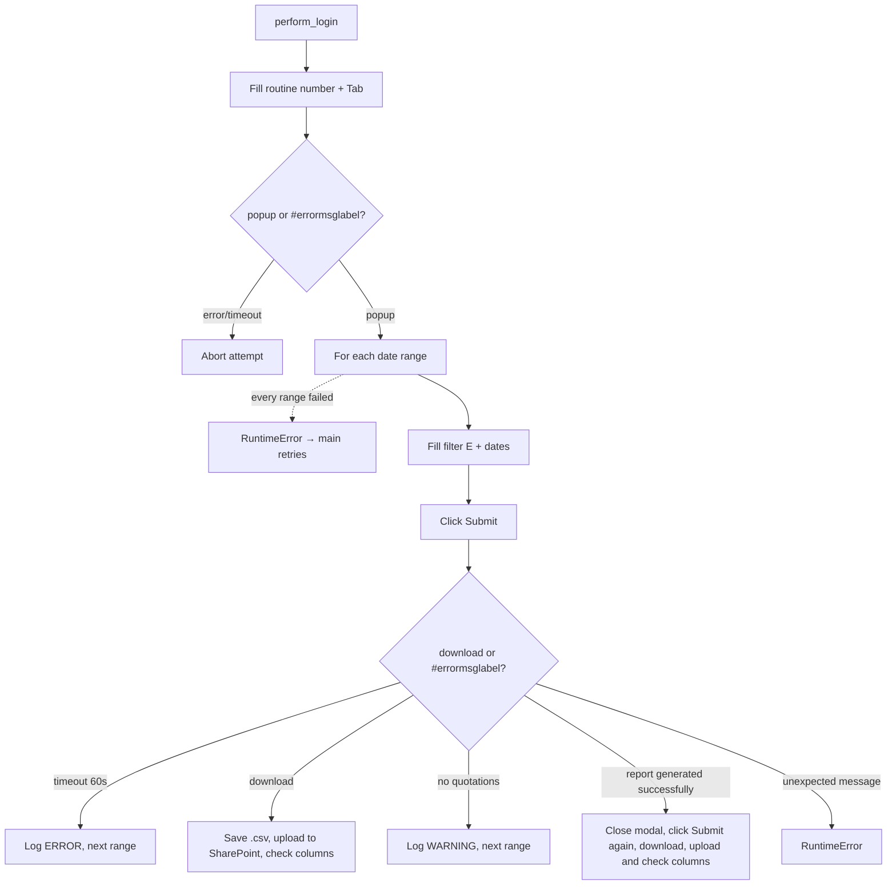

<h3># 📄 Routine 002</h3>

Automation for extracting, downloading, and uploading the quotation report for routine **002** of the SSW system to SharePoint.

---

## 📌 Objective

Run routine 002 in SSW, generating the quotation report (type filter `E`) for two periods (previous month + current month to date), waiting for it to be generated, and uploading the resulting `.csv` to SharePoint.

---

## 📅 Business Rule (Dates)

| Condition | Periods processed | Function |
| --- | --- | --- |
| Always | Previous month (full) **and** current month up to today | `Dates().previous_and_current_month_ranges()` |

No day/hour gate: this routine belongs to the "always backfill last month" group (002, 036, 073, 076, 119, 200, 324, 411, 442, 452, 467 and 493), whose date helper is a one-to-one wrap of `Dates().previous_and_current_month_ranges()`. Each range is processed in isolation — a failure in one does not stop the other.

---

## 🔁 Execution Flow



---

## 🖱️ Screen Selectors

| Field | Selector | Note |
| --- | --- | --- |
| Routine number | `[id="\33 "]` | Triggers the popup via `Tab` |
| Type filter | `[id="\36 "]` | Filled with `E` |
| Start date | `[id="\31 7"]` | |
| End date | `[id="\31 8"]` | |
| Submit button | `[id="\31 9"]` | |
| Error label | `#errormsglabel` | |
| Confirm button | link **"7. OK"** | |

---

## ⚠️ Error Handling

| Scenario | Trigger | Action |
| --- | --- | --- |
| Timeout at the menu / form | Neither popup/download nor message within the timeout | Logs `ERROR`, period/attempt fails |
| `"Não existem cotações cadastradas..."` (no quotations for the date) | No data for the period | Logs `WARNING`, moves to the next period |
| `"Relatório gerado com sucesso."` (report generated successfully) | Report became ready for a second call | Closes the modal, clicks submit again to download |
| Unexpected message | Text not recognized | Dismissed with OK, `RuntimeError` → logged `ERROR` by the loop, next range |
| Every date range failed | Every `_process_date_range` call raised | `RuntimeError` "All N date range(s) failed" → attempt fails, `main()` retries |
| `"Opção não liberada"` (option not released) | `MSG_NOT_RELEASED` | Aborts the remaining attempts |

---

## 🔄 Resilience

- Up to **3 attempts** (`MAX_ATTEMPTS`), with `5s` between them.
- Standard multi-range loop: `handler_download` runs `_process_date_range` once per date range; a failure is logged as one `ERROR` line and the next date range still runs. The attempt only fails (and `main()` retries) when **every** date range failed.
- Aborts before the 3rd attempt if the message is `MSG_NOT_RELEASED`.
- Single cleanup at the end: `GarbageCollector` on `output/downloads/002/`, then the domain log upload, then the `Main routine completed.` line — always the last line of the run.

---

## 🛡️ Column Sentinel

Every downloaded file is checked against a fixed column baseline right after the upload. The result is **one line in the domain log**, which closes that file's block — it never raises and never affects the upload (see [column_sentinel.md](./column_sentinel.md)).

| Baseline | Columns | Header |
| --- | --- | --- |
| `config/sentinel/002.yml` | 40 | auto-detected |

- **Where it runs:** `bot_002.py`, in both download paths (direct download and after *"Relatório gerado com sucesso."*), right after `download.save_as(...)` and after `upload_report_file(...)`.
- **Processing before the check:** None — the raw SSW file is checked, exactly as it is uploaded.
- **Note:** The empty 41st column (SSW's trailing `;`) is ignored and not listed in the baseline.

Log line when the layout is intact:

```
SNTL - RPV SENTINEL 002 | 2026-09-RPV-002.csv | Columns: 40 found / 40 expected | OK
```

Any change shows up as `DRIFT` with `ADDED` / `REMOVED` / `RENAMED` / `MOVED` and the Excel column letter; a broken baseline shows up as `ERROR`.

---

## 📤 Output

- File: `output/downloads/002/20YY-MM-<DOMAIN>-002.csv`
- SharePoint destination: `Banco_de_Dados/<DOMAIN>/002`

---

## 🗂 Related Files

- `app/routines/bot_002.py` — routine code.
- `app/utils/datetime_utils.py` — period calculation (`Dates`).
- `app/core/login.py` / `app/core/upload_to_sharepoint.py` / `app/utils/custom_logger.py` / `app/utils/cleanup.py`
- `app/core/column_sentinel.py` — column check (see [column_sentinel.md](./column_sentinel.md)).
- `config/sentinel/002.yml` — column baseline.

---

## 📈 Example Run

```bash
uv run python main.py 002
```

[⬅ Back to main README](../README.md)
