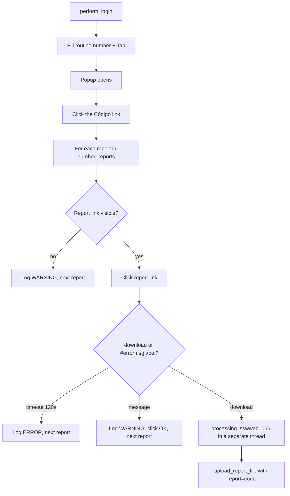

<h3># 📄 Routine 056</h3>

Automation for extracting, processing, and uploading `.sswweb` reports for routine **056** of the SSW system to SharePoint.

---

## 📌 Objective

For each configured report code, download the matching `.sswweb` file, convert it with `Dataframe_Analytics().processing_sswweb_056()`, and upload the result to SharePoint.

---

## ⚙️ Business Parameter

Unlike most routines, 056 does **not** use a date range — it iterates over a list of report codes configured in `config.yml`:

```yaml
variables:
  bot_056:
    number_reports: ['020', '023']
```

Each code is read via `settings.yaml_config.variables.bot_056.number_reports` (falls back to `['020', '023']` if absent). Each report is isolated — a failure in one does not stop the others.

---

## 🔁 Execution Flow



The routine-level popup (`B`→`C`) is opened with a plain `expect_popup()` (no race against `#errormsglabel`) — the 056 menu doesn't usually return an error at this step. The per-report download (`H`→`I`) does race the download against `#errormsglabel`, following the `handler_download` convention used across the other routines, instead of blindly waiting out `expect_download()`'s own timeout when a report fails.

---

## 🖱️ Screen Selectors

| Field | Selector | Note |
| --- | --- | --- |
| Routine number | `[id="\33 "]` | Triggers the popup via `Tab` |
| Sort link | link **"Código"** | Clicked before looking for the report links |
| Report link | link matching the code text (e.g. `"020"`) | One per item in `number_reports` |
| Error label | `#errormsglabel` | |
| Confirm button | link **"7. OK"** | |

---

## ⚠️ Error Handling

| Scenario | Trigger | Action |
| --- | --- | --- |
| Report link not found/visible | Code not available on screen | Logs `WARNING`, moves to the next code |
| Timeout | Neither the download nor a message appears within 120s | Logs `ERROR`, next report |
| Message appears instead of a download | `#errormsglabel` becomes visible | Logs `WARNING` with the message text, dismissed with OK, next report |
| Failure downloading/processing/uploading a report | Exception during the loop | Logs `ERROR` with the code, moves on (isolated by `try/except`) |
| `"Opção não liberada"` (option not released) | `MSG_NOT_RELEASED` | Aborts the remaining attempts |

---

## 🔄 Resilience

- Up to **3 attempts** (`MAX_ATTEMPTS`), with `5s` between them.
- Aborts before the 3rd attempt if the message is `MSG_NOT_RELEASED`.
- Single cleanup at the end: domain log upload + `GarbageCollector` on `output/downloads/056/`.

---

## 📤 Output

- Raw file: `output/downloads/056/YYYY-MM-DD-<DOMAIN>-056-<report>.sswweb`
- Processed file: produced by `Dataframe_Analytics().processing_sswweb_056()`.
- SharePoint destination: `Banco_de_Dados/<DOMAIN>/056/<report>`

---

## 🗂 Related Files

- `app/routines/bot_056.py` — routine code.
- `app/core/data_processing.py` — `.sswweb` conversion (`Dataframe_Analytics`).
- `app/core/login.py` / `app/core/upload_to_sharepoint.py` / `app/utils/custom_logger.py` / `app/utils/cleanup.py`

---

## 📈 Example Run

```bash
uv run python main.py 056
```

[⬅ Back to main README](../README.md)
