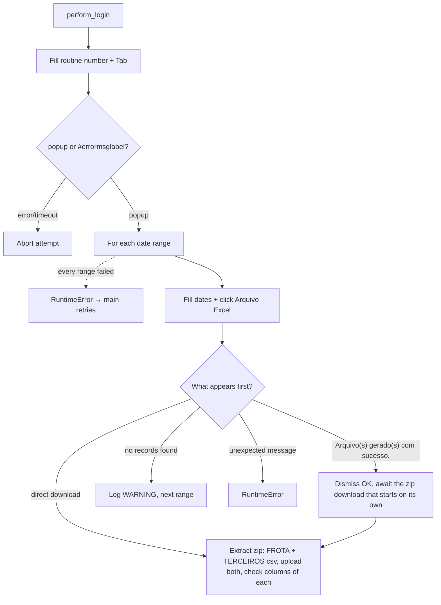

<h3># 📄 Routine 073</h3>

Automation for extracting, downloading, and uploading the vehicle report (fleet/third-party) for routine **073** of the SSW system to SharePoint.

---

## 📌 Objective

Run routine 073 in SSW for two periods (previous month + current month to date). The report is delivered as a single `.zip` containing both the FROTA and TERCEIROS csv files, which the bot extracts and re-uploads separately — or, if SSW shows a "no records" / unexpected message instead, handled accordingly.

---

## 📅 Business Rule (Dates)

| Condition | Periods processed | Function |
| --- | --- | --- |
| Always | Previous month (full) **and** current month up to today | `Dates().previous_and_current_month_ranges()` |

No day/hour gate: this routine belongs to the "always backfill last month" group (002, 036, 073, 076, 119, 200, 324, 411, 442, 452, 467 and 493), whose date helper is a one-to-one wrap of `Dates().previous_and_current_month_ranges()`. Each range is processed in isolation — a failure in one does not stop the other.

---

## 🔁 Execution Flow



**Particularity of this routine:** the "Arquivo Excel" button races two concurrent tasks (`download` vs `#errormsglabel`). As of 2026-09, SSW delivers a single `.zip` containing both the FROTA and TERCEIROS csv files (randomly-prefixed filenames, matched by the fixed `"frota"`/`"terceiro"` substring in `_match_zip_entry_type()`) instead of showing separate "Baixar arquivo..." links — the zip download either starts directly, or is preceded by an "Aviso: Arquivo(s) gerado(s) com sucesso." message that is dismissed before awaiting the download. **The old per-category link scenario (separate "Baixar arquivo de veículos terceiros/frota" links, no zip) is disabled but kept commented in `bot_073.py`** in case SSW reverts to it — see the `DISABLED` blocks in `_process_date_range()`.

---

## 🖱️ Screen Selectors

| Field | Selector | Note |
| --- | --- | --- |
| Routine number | `[id="\33 "]` | Triggers the popup via `Tab` |
| Start date | `#per_ini_inc` | |
| End date | `#per_fin_inc` | |
| Generate button | link **"Arquivo\xa0Excel"** | Non-breaking space, intentional |
| ~~Third-party vehicles link~~ | ~~`"Baixar arquivo de veículos terceiros"`~~ | Disabled — see the DISABLED blocks in `bot_073.py`; SSW no longer shows this link, it zips the file instead |
| ~~Fleet vehicles link~~ | ~~`"Baixar arquivo de veículos frota"`~~ | Same |
| Error label (also used for the "Aviso" success modal) | `#errormsglabel` | |
| Confirm button | link **"7. OK"** | |

---

## ⚠️ Error Handling

| Scenario | Trigger | Action |
| --- | --- | --- |
| Total timeout | Neither the download nor a message appear within 60s | `TimeoutError` |
| Direct zip download | `download` event, filename ends in `.zip` | Extracts FROTA/TERCEIROS csvs, uploads both (`073-TERCEIROS.csv` / `073-FROTA.csv`) |
| Direct non-zip download | `download` event, any other filename | Defensive fallback — saves as `073.csv` and uploads (pre-zip behavior, see `_save_and_upload()`) |
| `"Arquivo(s) gerado(s) com sucesso."` | Report generated | Not an error — dismisses "7. OK", awaits the zip download that starts on its own, then processes it as above |
| Zip with no recognizable file inside | Neither `frota` nor `terceiro` found in any entry name | `RuntimeError` |
| `"Nenhum registro encontrado"` (no records found) | No data for the period | Logs `WARNING`, moves on |
| Unexpected message | Text not recognized | Closes modal, `RuntimeError` → logged `ERROR` by the loop, next range |
| Every date range failed | Every `_process_date_range` call raised | `RuntimeError` "All N date range(s) failed" → attempt fails, `main()` retries |
| `"Opção não liberada"` (option not released) | `MSG_NOT_RELEASED` | Aborts the remaining attempts |

---

## 🔄 Resilience

- Up to **3 attempts** (`MAX_ATTEMPTS`), with `5s` between them.
- Standard multi-range loop: `handler_download` runs `_process_date_range` once per date range; a failure is logged as one `ERROR` line and the next date range still runs. The attempt only fails (and `main()` retries) when **every** date range failed.
- Aborts before the 3rd attempt if the message is `MSG_NOT_RELEASED`.
- Single cleanup at the end: `GarbageCollector` on `output/downloads/073/`, then the domain log upload, then the `Main routine completed.` line — always the last line of the run.

---

## 🛡️ Column Sentinel

Every downloaded file is checked against a fixed column baseline right after the upload. The result is **one line in the domain log**, which closes that file's block — it never raises and never affects the upload (see [column_sentinel.md](./column_sentinel.md)).

| Baseline | Columns | Header |
| --- | --- | --- |
| `config/sentinel/073-FROTA.yml` | 56 | auto-detected |
| `config/sentinel/073-TERCEIROS.yml` | 79 | auto-detected |

- **Where it runs:** `bot_073.py`, after each csv is extracted from the zip (`_extract_and_upload_zip`) and after its upload. Each file is checked against the baseline with the same name the bot gives it (`073-FROTA` / `073-TERCEIROS`). The non-zip fallback (`_save_and_upload`, file `073`) has no baseline, so it is not checked.
- **Processing before the check:** None — the raw SSW files are checked, exactly as they are uploaded.
- **Note:** Both files start with the SSW row counter (`'1'`). Two ranges × two files = 4 sentinel lines per run.

Log line when the layout is intact:

```
SNTL - TEC SENTINEL 073-FROTA | 2026-09-TEC-073-FROTA.csv | Columns: 56 found / 56 expected | OK
SNTL - TEC SENTINEL 073-TERCEIROS | 2026-09-TEC-073-TERCEIROS.csv | Columns: 79 found / 79 expected | OK
```

Any change shows up as `DRIFT` with `ADDED` / `REMOVED` / `RENAMED` / `MOVED` and the Excel column letter; a broken baseline shows up as `ERROR`.

---

## 📤 Output

- Normal (zip) path: `output/downloads/073/20YY-MM-<DOMAIN>-073-TERCEIROS.csv` and `...-073-FROTA.csv`, extracted from the downloaded `073-download.zip` (deleted after extraction)
- Fallback (non-zip direct download, pre-zip behavior): `output/downloads/073/20YY-MM-<DOMAIN>-073.csv`
- SharePoint destination: `Banco_de_Dados/<DOMAIN>/073`

---

## 🗂 Related Files

- `app/routines/bot_073.py` — routine code.
- `app/utils/datetime_utils.py` — period calculation (`Dates`).
- `app/core/login.py` / `app/core/upload_to_sharepoint.py` / `app/utils/custom_logger.py` / `app/utils/cleanup.py`
- `app/core/column_sentinel.py` — column check (see [column_sentinel.md](./column_sentinel.md)).
- `config/sentinel/073-FROTA.yml` — column baseline.
- `config/sentinel/073-TERCEIROS.yml` — column baseline.

---

## 📈 Example Run

```bash
uv run python main.py 073
```

[⬅ Back to main README](../README.md)
