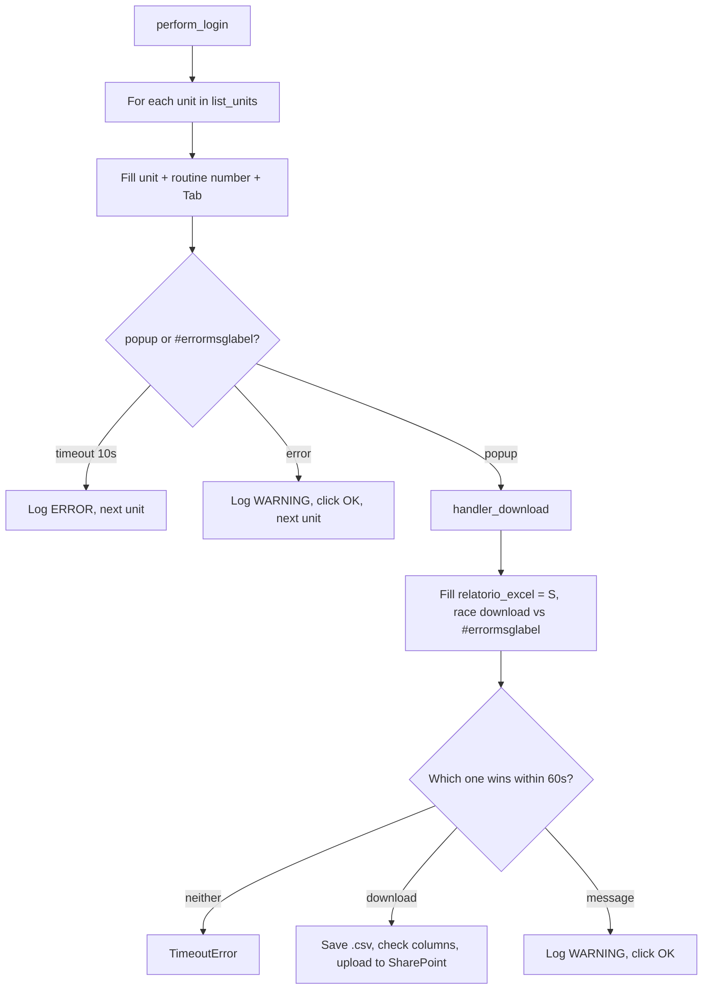

<h3># 📄 Routine 081</h3>

Automation for extracting, downloading, and uploading the delivery report for routine **081** of the SSW system to SharePoint, per unit.

---

## 📌 Objective

Run routine 081 once for each configured unit, with no date filter, filling the Excel-report checkbox and downloading the resulting `.csv`.

---

## ⚙️ Business Parameter

No date range — this screen has no date fields. Units processed: `config.yml` → `variables.bot_081.list_units`, read via `settings.yaml_config.variables.bot_081.list_units`. Each unit is isolated — a failure in one does not stop the others.

A fresh popup opens for **every** unit (unlike routines such as 076 that reuse one popup for the whole list), so each popup is explicitly closed after use.

---

## 🔁 Execution Flow



**Particularities of this routine:**

- No `MSG_*` messages are catalogued for this screen yet — when `#errormsglabel` appears inside the popup instead of a download, `handler_download` reads the text, dismisses it with OK, and logs a generic `WARNING`, rather than dispatching on specific known strings the way most other routines do.

---

## 🖱️ Screen Selectors

| Field | Selector | Note |
| --- | --- | --- |
| Unit | `[id="\32 "]` | |
| Routine number | `[id="\33 "]` | Triggers a new popup via `Tab`, every unit |
| Excel-report checkbox | `#relatorio_excel` | Filled with `S`, inside the popup |
| Submit | link **"1. Relacionar as entregas,"** | Non-breaking spaces between words, intentional |
| Error label | `#errormsglabel` | Reused both on the main menu page and inside the report popup |
| Confirm button | link **"7. OK"** | |

---

## ⚠️ Error Handling

| Scenario | Trigger | Action |
| --- | --- | --- |
| Timeout at the menu | Neither popup nor error within 10s | Logs `ERROR`, next unit |
| Menu-level error | `#errormsglabel` visible after `Tab` | Logs `WARNING`, dismissed with OK, next unit |
| Timeout in the popup | Neither the download nor a message appears within 60s | `TimeoutError`, next unit |
| Message appears instead of a download | `#errormsglabel` visible inside the popup | Logs `WARNING` with the message text, dismissed with OK, next unit |
| `"Opção não liberada"` (option not released) | `MSG_NOT_RELEASED` | Aborts the remaining attempts |

---

## 🔄 Resilience

- Up to **3 attempts** (`MAX_ATTEMPTS`), with `5s` between them.
- Aborts before the 3rd attempt if the message is `MSG_NOT_RELEASED`.
- Single cleanup at the end: domain log upload + `GarbageCollector` on `output/downloads/081/`.

---

## 🛡️ Column Sentinel

Every downloaded file is checked against a fixed column baseline before the upload. The result is **one line in the domain log** — the upload always proceeds (see [column_sentinel.md](./column_sentinel.md)).

| Baseline | Columns | Header |
| --- | --- | --- |
| `config/sentinel/081.yml` | 47 | auto-detected |

- **Where it runs:** `bot_081.py → handler_download`, right after `download.save_as(...)`.
- **Processing before the check:** None — the raw SSW file is checked, exactly as it is uploaded.
- **Note:** One file per unit → one sentinel line per unit per run.

Log line when the layout is intact:

```
INFO - TEC SENTINEL | 081 | TEC-ANJ-081.csv | Columns: 47 found / 47 expected | OK
```

Any change shows up as `DRIFT` with `ADDED` / `REMOVED` / `RENAMED` / `MOVED` and the Excel column letter; a broken baseline shows up as `ERROR`.

---

## 📤 Output

- File: `output/downloads/081/<DOMAIN>-<UNIT>-081.csv`
- SharePoint destination: `Banco_de_Dados/<DOMAIN>/081`

---

## 🗂 Related Files

- `app/routines/bot_081.py` — routine code.
- `config/settings/variables.py` — unit list (`Bot081.list_units`).
- `app/core/login.py` / `app/core/upload_to_sharepoint.py` / `app/utils/custom_logger.py` / `app/utils/cleanup.py`
- `app/core/column_sentinel.py` — column check (see [column_sentinel.md](./column_sentinel.md)).
- `config/sentinel/081.yml` — column baseline.

---

## 📈 Example Run

```bash
uv run python main.py 081
```

[⬅ Back to main README](../README.md)
