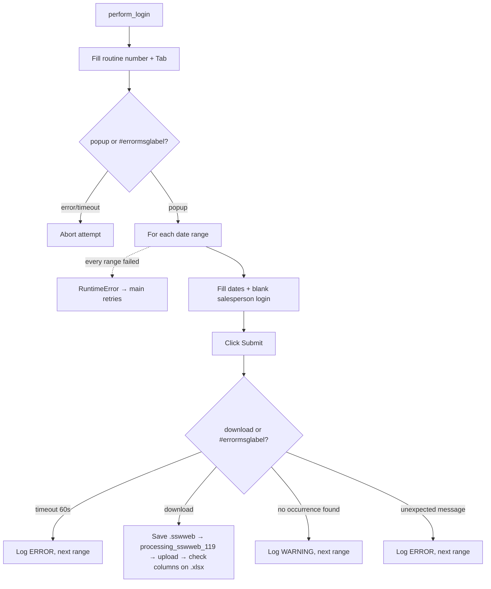

<h3># 📄 Routine 119</h3>

Automation for extracting, processing, and uploading the visit-occurrence report for routine **119** of the SSW system to SharePoint.

---

## 📌 Objective

Run routine 119 for two periods (previous month + current month to date, see Business Rule below), download the `.sswweb` for each, convert it with `Dataframe_Analytics().processing_sswweb_119()`, and upload the result to SharePoint.

---

## 📅 Business Rule (Dates)

| Condition | Periods processed | Function |
| --- | --- | --- |
| Always | Previous month (full) **and** current month up to today | `Dates().previous_and_current_month_ranges()` |

No day/hour gate: this routine belongs to the "always backfill last month" group (002, 036, 073, 076, 119, 200, 324, 411, 442, 452, 455ABH, 455CGK, 455F, 467 and 493), whose date helper is a one-to-one wrap of `Dates().previous_and_current_month_ranges()`. Each range is processed in isolation — a failure in one does not stop the other.

The salesperson login field is sent blank (`""`), i.e. the report covers all salespeople.

---

## 🔁 Execution Flow



---

## 🖱️ Screen Selectors

| Field | Selector | Note |
| --- | --- | --- |
| Routine number | `[id="\33 "]` | Triggers the popup via `Tab` |
| Start date | `#per_visita_ini_rel` | |
| End date | `#per_visita_fin_rel` | |
| Salesperson login | `#login_vend_rel` | Sent empty (all salespeople) |
| Submit button | `#btn_env_rel` | |
| Error label | `#errormsglabel` | |
| Confirm button | link **"7. OK"** | |

---

## ⚠️ Error Handling

| Scenario | Trigger | Action |
| --- | --- | --- |
| Timeout at the menu | Neither popup nor error within 10s | `TimeoutError`, attempt fails |
| Timeout per range | Neither download nor message within 60s | `TimeoutError` → logged `ERROR` by the loop, next range |
| Download OK | `download` event | Converts `.sswweb` via Pandas, uploads, logs `INFO` |
| `"Nenhuma ocorrência encontrada"` (no occurrence found) | No data for the period | Logs `WARNING`, next range |
| Unexpected message | Text not recognized | Dismissed with OK, `RuntimeError` → logged `ERROR` by the loop, next range |
| Every date range failed | Every `_process_date_range` call raised | `RuntimeError` "All N date range(s) failed" → attempt fails, `main()` retries |
| `"Opção não liberada"` (option not released) | `MSG_NOT_RELEASED` | Aborts the remaining attempts |

---

## 🔄 Resilience

- Up to **3 attempts** (`MAX_ATTEMPTS`), with `5s` between them.
- Standard multi-range loop: `handler_download` runs `_process_date_range` once per date range; a failure is logged as one `ERROR` line and the next date range still runs. The attempt only fails (and `main()` retries) when **every** date range failed.
- Aborts before the 3rd attempt if the message is `MSG_NOT_RELEASED`.
- Single cleanup at the end: `GarbageCollector` on `output/downloads/119/`, then the domain log upload, then the `Main routine completed.` line — always the last line of the run.

---

## 🛡️ Column Sentinel

> ⚠️ **Dormant today.** The header is built by `processing_sswweb_119` itself (hard-coded names), not read from SSW. So this check logs `OK` whatever SSW changes — it **validates nothing** while the routine is built this way. The baseline is kept ready (decided with the user on 2026-09-27) for when the processing stops hard-coding the column names; at that point it starts catching real changes with no code change.

Every downloaded file is checked against a fixed column baseline right after the upload. The result is **one line in the domain log**, which closes that file's block — it never raises and never affects the upload (see [column_sentinel.md](./column_sentinel.md)).

| Baseline | Columns | Header |
| --- | --- | --- |
| `config/sentinel/119.yml` | 7 | line 1 (first row of the `.xlsx`) |

- **Where it runs:** `bot_119.py → _process_date_range`, right after `processing_sswweb_119` (on the `.xlsx`).
- **Processing before the check:** `processing_sswweb_119` slices each `.sswweb` line by fixed character positions and writes an `.xlsx` with 7 **hard-coded** column names; the check reads that `.xlsx`.
- **Note:** What can really break today is invisible to it: shifted slices / a regex that stops matching produce wrong or empty data under a perfect header. A check inside the processing (e.g. `WARNING` on 0 extracted rows) would be the fitting guard for that.

Log line when the layout is intact:

```
SNTL - TEC SENTINEL 119 | 2026-09-TEC-119.xlsx | Columns: 7 found / 7 expected | OK
```

Any change shows up as `DRIFT` with `ADDED` / `REMOVED` / `RENAMED` / `MOVED` and the Excel column letter; a broken baseline shows up as `ERROR`.

---

## 📤 Output

- Raw file: `output/downloads/119/20YY-MM-<DOMAIN>-119.sswweb`
- Processed file: produced by `Dataframe_Analytics().processing_sswweb_119()`.
- SharePoint destination: `Banco_de_Dados/<DOMAIN>/119`

---

## 🗂 Related Files

- `app/routines/bot_119.py` — routine code.
- `app/core/data_processing.py` — report conversion (`Dataframe_Analytics`).
- `app/utils/datetime_utils.py` — period calculation (`Dates`).
- `app/core/login.py` / `app/core/upload_to_sharepoint.py` / `app/utils/cleanup.py`

---

## 📈 Example Run

```bash
uv run python main.py 119
```

[⬅ Back to main README](../README.md)
