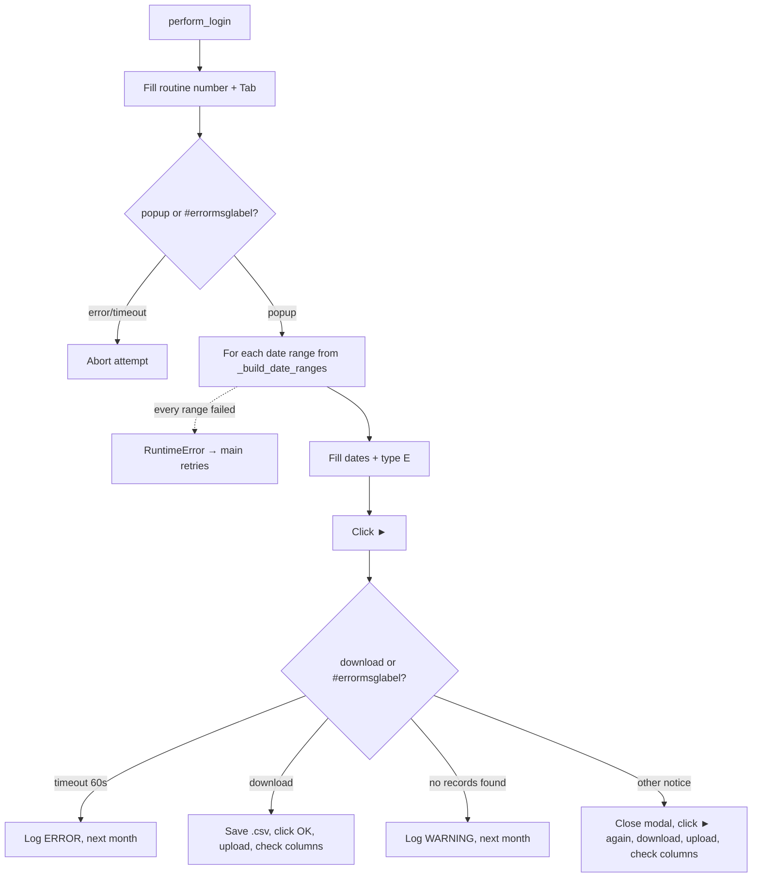

<h3># 📄 Routine 200</h3>

Automation for extracting, downloading, and uploading the delivery report for routine **200** of the SSW system to SharePoint.

---

## 📌 Objective

Run routine 200 for two periods (previous month + current month to date) (see Business Rule below), with a two-stage download flow: local generation, or a warning followed by a second download call.

---

## 📅 Business Rule (Dates)

| Condition | Periods processed | Function |
| --- | --- | --- |
| Always | Previous month (full) **and** current month up to today | `Dates().previous_and_current_month_ranges()` |

No day/hour gate: this routine belongs to the "always backfill last month" group (002, 036, 073, 076, 119, 200, 324, 411, 442, 452, 455ABH, 455CGK, 455F, 467 and 493), whose date helper is a one-to-one wrap of `Dates().previous_and_current_month_ranges()`. Each range is processed in isolation — a failure in one does not stop the other.

---

## 🔁 Execution Flow



---

## 🖱️ Screen Selectors

| Field | Selector | Note |
| --- | --- | --- |
| Routine number | `[id="\33 "]` | Triggers the popup via `Tab` |
| Start date | `[id="\31 "]` | |
| End date | `[id="\32 "]` | |
| Type | `[id="\31 1"]` | Filled with `E` |
| Submit button | link **"►"** | |
| Error label | `#errormsglabel` | |
| Confirm button | link **"7. OK"** | |

---

## ⚠️ Error Handling

| Scenario | Trigger | Action |
| --- | --- | --- |
| Timeout at the menu | Neither popup nor error within 10s | `TimeoutError`, attempt fails |
| Timeout per month | Neither download nor message within 60s | `TimeoutError` → logged `ERROR` by the loop, next month |
| Direct download | `download` event | Saves, dismisses the confirmation modal, uploads, checks columns, logs `INFO` |
| `"Nenhum registro encontrado"` (no records found) | No data for the period | Logs `WARNING`, moves on |
| Other notice (info) | Message isn't "no records" | Closes modal, clicks ► again to force the secondary download, uploads, checks columns |
| Exception in a range | e.g. the secondary download times out (120s) | Logs `ERROR`, next month |
| Every date range failed | Every `_process_date_range` call raised | `RuntimeError` "All N date range(s) failed" → attempt fails, `main()` retries |
| `"Opção não liberada"` (option not released) | `MSG_NOT_RELEASED` | Aborts the remaining attempts |

---

## 🔄 Resilience

- Up to **3 attempts** (`MAX_ATTEMPTS`), with `5s` between them.
- Standard multi-range loop: `handler_download` runs `_process_date_range` once per date range; a failure is logged as one `ERROR` line and the next date range still runs. The attempt only fails (and `main()` retries) when **every** date range failed.
- Aborts before the 3rd attempt if the message is `MSG_NOT_RELEASED`.
- Single cleanup at the end: `GarbageCollector` on `output/downloads/200/`, then the domain log upload, then the `Main routine completed.` line — always the last line of the run.

---

## 🛡️ Column Sentinel

Every downloaded file is checked against a fixed column baseline right after the upload. The result is **one line in the domain log**, which closes that file's block — it never raises and never affects the upload (see [column_sentinel.md](./column_sentinel.md)).

| Baseline | Columns | Header |
| --- | --- | --- |
| `config/sentinel/200.yml` | 70 | auto-detected |

- **Where it runs:** `bot_200.py → _process_date_range`, right after `download.save_as(...)` on both paths (direct download and after the info prompt).
- **Processing before the check:** None — the raw SSW file is checked, exactly as it is uploaded.
- **Note:** One file per month range → up to 2 sentinel lines per run.

Log line when the layout is intact:

```
SNTL - TEC SENTINEL 200 | 2026-09-TEC-200.csv | Columns: 70 found / 70 expected | OK
```

Any change shows up as `DRIFT` with `ADDED` / `REMOVED` / `RENAMED` / `MOVED` and the Excel column letter; a broken baseline shows up as `ERROR`.

---

## 📤 Output

- File: `output/downloads/200/20YY-MM-<DOMAIN>-200.csv`
- SharePoint destination: `Banco_de_Dados/<DOMAIN>/200`

---

## 🗂 Related Files

- `app/routines/bot_200.py` — routine code.
- `app/utils/datetime_utils.py` — period calculation (`Dates`).
- `app/core/login.py` / `app/core/upload_to_sharepoint.py` / `app/utils/custom_logger.py` / `app/utils/cleanup.py`
- `app/core/column_sentinel.py` — column check (see [column_sentinel.md](./column_sentinel.md)).
- `config/sentinel/200.yml` — column baseline.

---

## 📈 Example Run

```bash
uv run python main.py 200
```

[⬅ Back to main README](../README.md)
