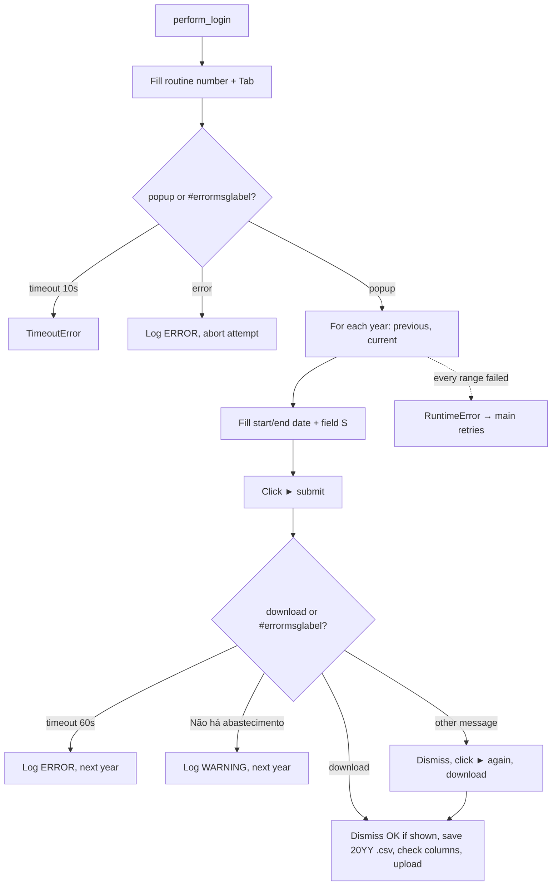

<h3># 📄 Routine 322</h3>

Automation for extracting, downloading, and uploading the fuel-supply report for routine **322** of the SSW system to SharePoint.

---

## 📌 Objective

Run routine 322 in SSW for two periods — the previous year (full) and the current year up to today — and upload one `.csv` per year to SharePoint.

---

## 📅 Business Rule (Dates)

| Periods processed | Function |
| --- | --- |
| Previous calendar year (full) **and** current year up to today | `_build_date_ranges()` → `Dates().previous_and_current_year_ranges()` |

Not gated by a day/hour check — both years are always fetched. Each year is processed in isolation: a failure in one does not stop the other, and the attempt only fails (triggering a retry) when **both** years failed.

---

## 🔁 Execution Flow



Opening the routine races the popup against the menu-level error label (`MSG_NOT_RELEASED`) instead of assuming the popup always opens.

---

## 🖱️ Screen Selectors

| Field | Selector | Note |
| --- | --- | --- |
| Routine number | `[id="\33 "]` | Triggers the popup via `Tab` |
| Start date | `[id="\33 "]` | Same id as the routine field, inside the popup |
| End date | `[id="\34 "]` | |
| Field S | `[id="\35 "]` | Filled with `S` |
| Submit button | link **"►"** | |
| Error label | `#errormsglabel` | |
| Confirm button | link **"7. OK"** | |

---

## ⚠️ Error Handling

| Scenario | Trigger | Action |
| --- | --- | --- |
| Timeout at the menu | Neither popup nor error within 10s | `TimeoutError`, attempt fails |
| Error opening the routine | `#errormsglabel` visible after `Tab` | Closes modal, logs `ERROR`, `RuntimeError` propagated |
| Timeout at the form | Neither download nor message within 60s | Logs `ERROR`, next year |
| `"Não há abastecimento"` (no fuel supply) | No data for the year | Logs `WARNING`, next year (not a failure) |
| Any other message | `#errormsglabel` visible | Dismiss, click submit again to trigger the download (120s) |
| Download missing after all scenarios | No download object produced | Logs `ERROR`, next year |
| Every date range failed | Every `_process_date_range` call raised | `RuntimeError` "All N date range(s) failed" → attempt fails, `main()` retries |
| `"Opção não liberada"` (option not released) | `MSG_NOT_RELEASED` | Aborts the remaining attempts |

---

## 🔄 Resilience

- Up to **3 attempts** (`MAX_ATTEMPTS`), with `5s` between them.
- Standard multi-range loop: `handler_download` runs `_process_date_range` once per date range; a failure is logged as one `ERROR` line and the next date range still runs. The attempt only fails (and `main()` retries) when **every** date range failed.
- Aborts before the 3rd attempt if the message is `MSG_NOT_RELEASED`.
- Single cleanup at the end: domain log upload + `GarbageCollector` on `output/downloads/322/`.

---

## 🛡️ Column Sentinel

Every downloaded file is checked against a fixed column baseline before the upload. The result is **one line in the domain log** — the upload always proceeds (see [column_sentinel.md](./column_sentinel.md)).

| Baseline | Columns | Header |
| --- | --- | --- |
| `config/sentinel/322.yml` | 17 | auto-detected |

- **Where it runs:** `bot_322.py → _process_date_range`, right after `download.save_as(...)` (covers both the direct and the after-prompt download).
- **Processing before the check:** None — the raw SSW file is checked, exactly as it is uploaded.
- **Note:** One file per year → up to 2 sentinel lines per run.

Log line when the layout is intact:

```
INFO - TEC SENTINEL | 322 | 2026-TEC-322.csv | Columns: 17 found / 17 expected | OK
```

Any change shows up as `DRIFT` with `ADDED` / `REMOVED` / `RENAMED` / `MOVED` and the Excel column letter; a broken baseline shows up as `ERROR`.

---

## 📤 Output

- Files: `output/downloads/322/20YY-<DOMAIN>-322.csv` — one per year (e.g. `2025-TEC-322.csv` and `2026-TEC-322.csv`)
- SharePoint destination: `Banco_de_Dados/<DOMAIN>/322`

---

## 🗂 Related Files

- `app/routines/bot_322.py` — routine code.
- `app/utils/datetime_utils.py` — `previous_and_current_year_ranges()`.
- `app/core/login.py` / `app/core/upload_to_sharepoint.py` / `app/utils/custom_logger.py` / `app/utils/cleanup.py`
- `app/core/column_sentinel.py` — column check (see [column_sentinel.md](./column_sentinel.md)).
- `config/sentinel/322.yml` — column baseline.

---

## 📈 Example Run

```bash
uv run python main.py 322
```

[⬅ Back to main README](../README.md)
