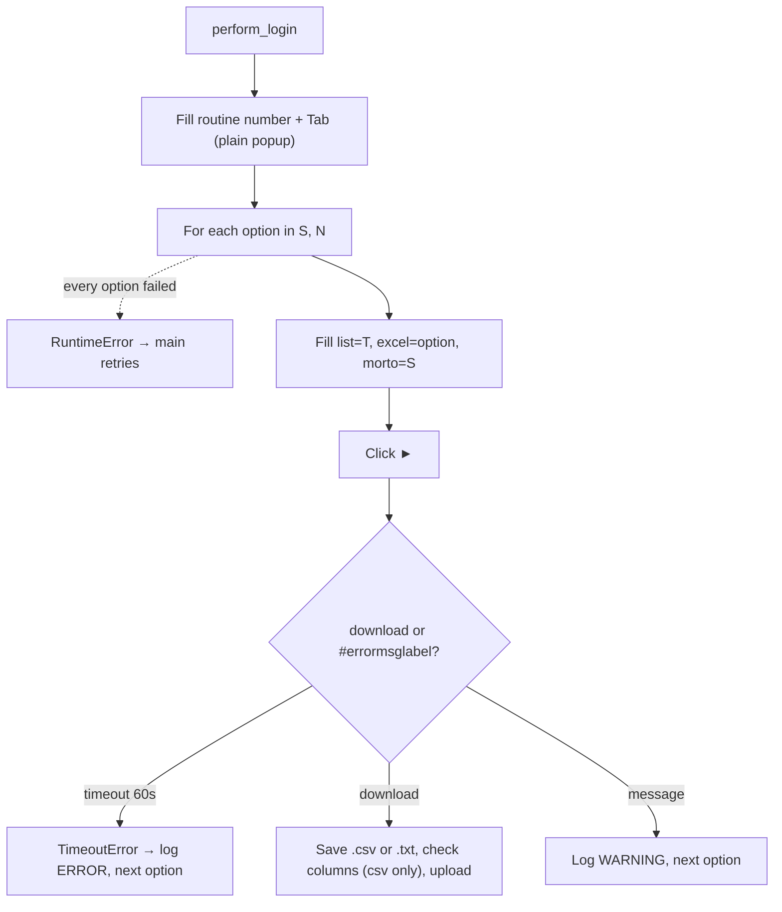

<h3># 📄 Routine 435</h3>

Automation for extracting, downloading, and uploading the report for routine **435** of the SSW system to SharePoint, in two formats.

---

## 📌 Objective

Run routine 435 twice — once for `.csv` and once for `.txt` — from the same screen, with no date filter.

---

## ⚙️ Business Parameter

There is no date period. The bot iterates over `LIST_OPTIONS = ["S", "N"]`, where each value feeds the report format field:

| Option | Extension generated |
| --- | --- |
| `S` (`OPTION_CSV`) | `.csv` — checked by the column sentinel |
| `N` (`OPTION_TXT`) | `.txt` — text report, no column header, not checked |

Each option is isolated — a failure in one does not stop the other; the attempt only fails when **both** options failed.

---

## 🔁 Execution Flow



---

## 🖱️ Screen Selectors

| Field | Selector | Note |
| --- | --- | --- |
| Routine number | `[id="\33 "]` | |
| List | `#t_rel_lista` | Filled with `T` |
| Excel/format | `#t_excel` | Filled with `S` or `N` (each option) |
| Read dead | `#t_ler_morto` | Filled with `S` |
| Submit button | link **"►"** | |
| Error label | `#errormsglabel` | |
| Confirm button | link **"7. OK"** | |

---

## ⚠️ Error Handling

| Scenario | Trigger | Action |
| --- | --- | --- |
| Timeout per option | Neither download nor message within 60s | `TimeoutError` → logged `ERROR` by the loop, next option |
| Download OK | `download` event | Saves with the matching extension, checks columns (csv only), uploads, logs `INFO` |
| Any message | `#errormsglabel` visible | Logs `WARNING`, next option (text is not interpreted; not a failure) |
| Every option failed | Every `_process_option` call raised | `RuntimeError` "All N option(s) failed" → attempt fails, `main()` retries |
| `"Opção não liberada"` (option not released) | `MSG_NOT_RELEASED` | Aborts the remaining attempts |

---

## 🔄 Resilience

- Up to **3 attempts** (`MAX_ATTEMPTS`), with `5s` between them.
- Standard loop: `handler_download` runs `_process_option` once per option; a failure is logged as one `ERROR` line and the next option still runs. The attempt only fails (and `main()` retries) when **every** option failed.
- Aborts before the 3rd attempt if the message is `MSG_NOT_RELEASED`.
- Single cleanup at the end: domain log upload + `GarbageCollector` on `output/downloads/435/`.

---

## 🛡️ Column Sentinel

Every downloaded csv is checked against a fixed column baseline before the upload. The result is **one line in the domain log** — the upload always proceeds (see [column_sentinel.md](./column_sentinel.md)).

| Baseline | Columns | Header |
| --- | --- | --- |
| `config/sentinel/435.yml` | 39 | auto-detected |

- **Where it runs:** `bot_435.py → _process_option`, right after `download.save_as(...)`, only for `OPTION_CSV` (`S`).
- **Processing before the check:** None — the raw SSW file is checked, exactly as it is uploaded.
- **Note:** The `.txt` (option `N`) is a text report with no column header, so it is never checked.

Log line when the layout is intact:

```
INFO - TEC SENTINEL | 435 | TEC-435.csv | Columns: 39 found / 39 expected | OK
```

Any change shows up as `DRIFT` with `ADDED` / `REMOVED` / `RENAMED` / `MOVED` and the Excel column letter; a broken baseline shows up as `ERROR`.

---

## 📤 Output

- Files: `output/downloads/435/<DOMAIN>-435.csv` and `output/downloads/435/<DOMAIN>-435.txt`
- SharePoint destination: `Banco_de_Dados/<DOMAIN>/435`

---

## 🗂 Related Files

- `app/routines/bot_435.py` — routine code.
- `app/core/login.py` / `app/core/upload_to_sharepoint.py` / `app/utils/custom_logger.py` / `app/utils/cleanup.py`
- `app/core/column_sentinel.py` — column check (see [column_sentinel.md](./column_sentinel.md)).
- `config/sentinel/435.yml` — column baseline (csv only).

---

## 📈 Example Run

```bash
uv run python main.py 435
```

[⬅ Back to main README](../README.md)
