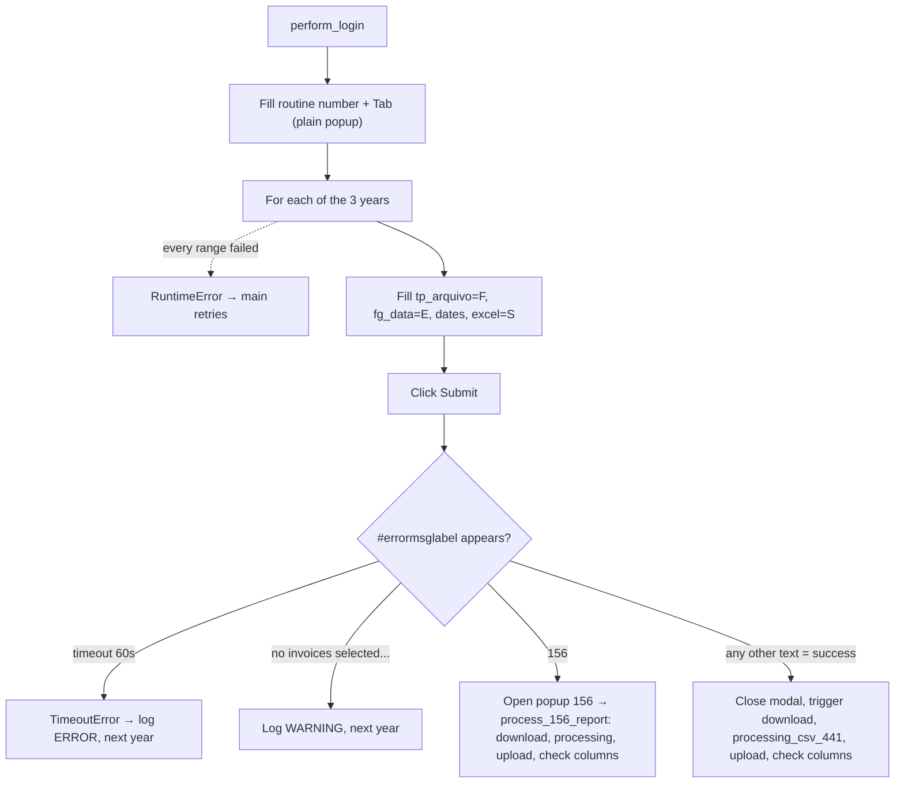

<h3># 📄 Routine 441</h3>

Automation for extracting, processing, and uploading the invoice report for routine **441** of the SSW system to SharePoint.

---

## 📌 Objective

Run routine 441 for three years of periods, routing between "no invoices", screen 156, or a direct download followed by Pandas processing.

---

## 📅 Business Rule (Dates)

| Periods processed | Function |
| --- | --- |
| Last 3 years (one range per year) | `Dates().last_three_years_to_date_ranges()` |

Each range is isolated — a failure in one does not stop the others.

---

## 🔁 Execution Flow



---

## 🖱️ Screen Selectors

| Field | Selector | Note |
| --- | --- | --- |
| Routine number | `[id="\33 "]` | |
| File type | `#tp_arquivo` | Filled with `F` |
| Date flag | `#rel_ana_fg_data` | Filled with `E` |
| Start date | `#rel_ana_per_pesq_ini` | |
| End date | `#rel_ana_per_pesq_fin` | |
| Excel | `#rel_ana_arq_excel` | Filled with `S` |
| Submit button | `#btn_env_rel_ana` | |
| Link to screen 156 | `"1. Abrir a opção 156 agora"` | |
| Error label | `#errormsglabel` | |
| Confirm button | link **"7. OK"** | |

---

## ⚠️ Error Handling

| Scenario | Trigger | Action |
| --- | --- | --- |
| Timeout | No message within 60s | `TimeoutError` → logged `ERROR` by the loop, next year |
| `"Não selecionou faturas para impressão"` (no invoices selected for printing) | No invoices for the period | Logs `WARNING`, moves on |
| `"156"` | Report sent for asynchronous processing | Opens popup and delegates to `process_156_report` |
| Any other text | Treated as a success confirmation | Closes modal, triggers a direct download, processes with `processing_csv_441`, uploads, checks columns |
| Every date range failed | Every `_process_date_range` call raised | `RuntimeError` "All N date range(s) failed" → attempt fails, `main()` retries |
| `"Opção não liberada"` (option not released) | `MSG_NOT_RELEASED` | Aborts the remaining attempts |

---

## 🔄 Resilience

- Up to **3 attempts** (`MAX_ATTEMPTS`), with `5s` between them.
- Standard multi-range loop: `handler_download` runs `_process_date_range` once per date range; a failure is logged as one `ERROR` line and the next date range still runs. The attempt only fails (and `main()` retries) when **every** date range failed.
- Aborts before the 3rd attempt if the message is `MSG_NOT_RELEASED`.
- Single cleanup at the end: `GarbageCollector` on `output/downloads/441/`, then the domain log upload, then the `Main routine completed.` line — always the last line of the run.

---

## 🛡️ Column Sentinel

> ⚠️ **Dormant today.** `processing_csv_441` forces the header to `config.yml → columns_441` (fills missing columns with blanks, drops extras, reorders). So this check logs `OK` whatever SSW changes — it **validates nothing** while the routine is built this way. The baseline is kept ready (decided with the user on 2026-09-27) for when the fixed column list is replaced by another method; at that point it starts catching real changes with no code change.

Every downloaded file is checked against a fixed column baseline right after the upload. The result is **one line in the domain log**, which closes that file's block — it never raises and never affects the upload (see [column_sentinel.md](./column_sentinel.md)).

| Baseline | Columns | Header |
| --- | --- | --- |
| `config/sentinel/441.yml` | 53 | line 1 |

- **Where it runs:** Direct download: `bot_441.py → _process_date_range`, right after `processing_csv_441`. Screen-156 path: `downloads.py → process_156_report` (after `_handle_441`'s processing).
- **Processing before the check:** `processing_csv_441` renames `Unnamed: 53` → `Unnamed: 52`, **creates any missing column as blank**, and keeps only `config.yml → variables.bot_441.columns_441`, in that order. The baseline must stay identical to that list (starts with `'1'`, ends with `Unnamed: 52`).
- **Note:** Tested on 2026-09-27: a raw file **missing `SERASA`** came out of the processing with `SERASA` blank and the check logged `OK`. That is the risk to keep in mind — a removed SSW column reaches Power BI as an empty column, silently.

Log line when the layout is intact:

```
SNTL - AGE SENTINEL 441 | 2026-AGE-441.csv | Columns: 53 found / 53 expected | OK
```

Any change shows up as `DRIFT` with `ADDED` / `REMOVED` / `RENAMED` / `MOVED` and the Excel column letter; a broken baseline shows up as `ERROR`.

---

## 📤 Output

- Raw file: `output/downloads/441/20YY-<DOMAIN>-441.csv`
- Processed file: produced by `Dataframe_Analytics().processing_csv_441()`.
- SharePoint destination: `Banco_de_Dados/<DOMAIN>/441`

---

## 🗂 Related Files

- `app/routines/bot_441.py` — routine code.
- `app/core/data_processing.py` — CSV post-processing (`Dataframe_Analytics`).
- `app/core/downloads.py` — screen 156 monitoring (`process_156_report`).
- `app/utils/datetime_utils.py` — period calculation (`Dates`).
- `config/settings/variables.py` — expected columns (`Bot441.columns_441`).
- `app/core/column_sentinel.py` — column check (see [column_sentinel.md](./column_sentinel.md)).
- `config/sentinel/441.yml` — column baseline (dormant; must match `columns_441`).
- `app/core/login.py` / `app/core/upload_to_sharepoint.py` / `app/utils/custom_logger.py` / `app/utils/cleanup.py`

---

## 📈 Example Run

```bash
uv run python main.py 441
```

[⬅ Back to main README](../README.md)
