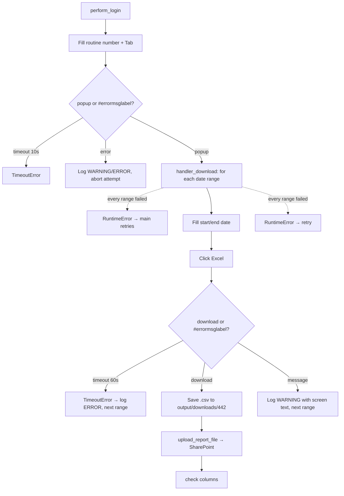

<h3># 📄 Routine 442</h3>

Automation for extracting, downloading, and uploading the report for routine **442** of the SSW system to SharePoint.

---

## 📌 Objective

Run routine 442 in SSW for two periods (previous month + current month to date), filling in the date filters, waiting for each `.csv` report to be generated, and automatically uploading it to SharePoint.

---

## 📅 Business Rule (Dates)

The periods are decided in `_build_date_ranges()`:

| Condition | Periods processed | Function |
| --- | --- | --- |
| Always | Previous month (full) **and** current month up to today | `Dates().previous_and_current_month_ranges()` |

No day/hour gate: this routine belongs to the "always backfill last month" group (002, 036, 073, 076, 119, 200, 324, 411, 442, 452, 455ABH, 455CGK, 455F, 467 and 493), whose date helper is a one-to-one wrap of `Dates().previous_and_current_month_ranges()`.

Each range is isolated — a failure in one does not stop the other — but if **every** range fails, `handler_download` raises `RuntimeError` so `main()`'s retry loop still engages.

---

## 🔁 Execution Flow



Every "wait for outcome" step uses `asyncio.wait([...], return_when=FIRST_COMPLETED)` — the bot reacts to whichever happens first (download, popup, or error message) instead of waiting for a fixed browser timeout.

---

## 🖱️ Screen Selectors

| Field | Selector | Note |
| --- | --- | --- |
| Routine number | `[id="\33 "]` | Triggers the popup via `Tab` |
| Start date | `[id="9"]` | |
| End date | `[id="10"]` | |
| Generate button | link **"Excel"** | |
| Error label | `#errormsglabel` | Shared by login, menu, and form |
| Confirm button | link **"7. OK"** | Closes the message modal |

---

## ⚠️ Error Handling

| Scenario | Trigger | Action |
| --- | --- | --- |
| Timeout at the menu | Neither popup nor error within 10s | `TimeoutError`, attempt fails |
| Error opening the routine | `#errormsglabel` visible after `Tab` | Closes modal, logs `ERROR`, `RuntimeError` propagated |
| Timeout at the form | Neither download nor error within 60s | `TimeoutError` for that range, logged `ERROR`, next range runs |
| Download OK | `download` event fired | Saves, uploads, checks columns, logs `INFO` |
| Message on the form | `#errormsglabel` visible after submit | Closes modal, logs `WARNING` with the text, next range runs (not a failure) |
| Every date range failed | Every `_process_date_range` call raised | `RuntimeError` "All N date range(s) failed" → attempt fails, `main()` retries |
| `"Opção não liberada"` (option not released) | Message contains `MSG_NOT_RELEASED` | **Aborts remaining attempts** — retrying wouldn't help |

---

## 🔄 Resilience

- Up to **3 attempts** (`MAX_ATTEMPTS`), with a `5s` wait between them.
- Standard multi-range loop: `handler_download` runs `_process_date_range` once per date range; a failure is logged as one `ERROR` line and the next date range still runs. The attempt only fails (and `main()` retries) when **every** date range failed.
- Aborts before the 3rd attempt if the message is `MSG_NOT_RELEASED` (option unavailable for this user/profile).
- At the end (success or failure), always runs a single cleanup:
  1. Sends files in `output/downloads/442/` to the trash (`GarbageCollector`).
  2. Uploads the domain log to SharePoint (`upload_log_file`).
  3. Logs `Main routine completed.` — always the last line of the run.

---

## 🛡️ Column Sentinel

Every downloaded file is checked against a fixed column baseline right after the upload. The result is **one line in the domain log**, which closes that file's block — it never raises and never affects the upload (see [column_sentinel.md](./column_sentinel.md)).

| Baseline | Columns | Header |
| --- | --- | --- |
| `config/sentinel/442.yml` | 15 | auto-detected |

- **Where it runs:** `bot_442.py → _process_date_range`, right after `download.save_as(...)`.
- **Processing before the check:** None — the raw SSW file is checked, exactly as it is uploaded.
- **Note:** Column I is `'UNID PAGAGDOR'` — SSW's own misspelling, kept on purpose. If SSW fixes it, the log shows `RENAMED: [I] 'UNID PAGAGDOR' -> 'UNID PAGADOR'`; update the YAML then.

Log line when the layout is intact:

```
SNTL - TEC SENTINEL 442 | 2026-09-TEC-442.csv | Columns: 15 found / 15 expected | OK
```

Any change shows up as `DRIFT` with `ADDED` / `REMOVED` / `RENAMED` / `MOVED` and the Excel column letter; a broken baseline shows up as `ERROR`.

---

## 📤 Output

- Files: `output/downloads/442/20YY-MM-<DOMAIN>-442.csv`, one per range (previous month and current month)
- SharePoint destination: `Banco_de_Dados/<DOMAIN>/442`

---

## 🗂 Related Files

- `app/routines/bot_442.py` — routine code.
- `app/utils/datetime_utils.py` — period calculation (`Dates`).
- `app/core/login.py` — SSW login (`perform_login`).
- `app/core/upload_to_sharepoint.py` — report and log upload (Graph API).
- `app/utils/custom_logger.py` — per-domain file logger (`get_logger`).
- `app/utils/cleanup.py` — download cleanup (`GarbageCollector`).
- `app/core/column_sentinel.py` — column check (see [column_sentinel.md](./column_sentinel.md)).
- `config/sentinel/442.yml` — column baseline.

---

## 📈 Example Run

```bash
uv run python main.py 442
```

[⬅ Back to main README](../README.md)
