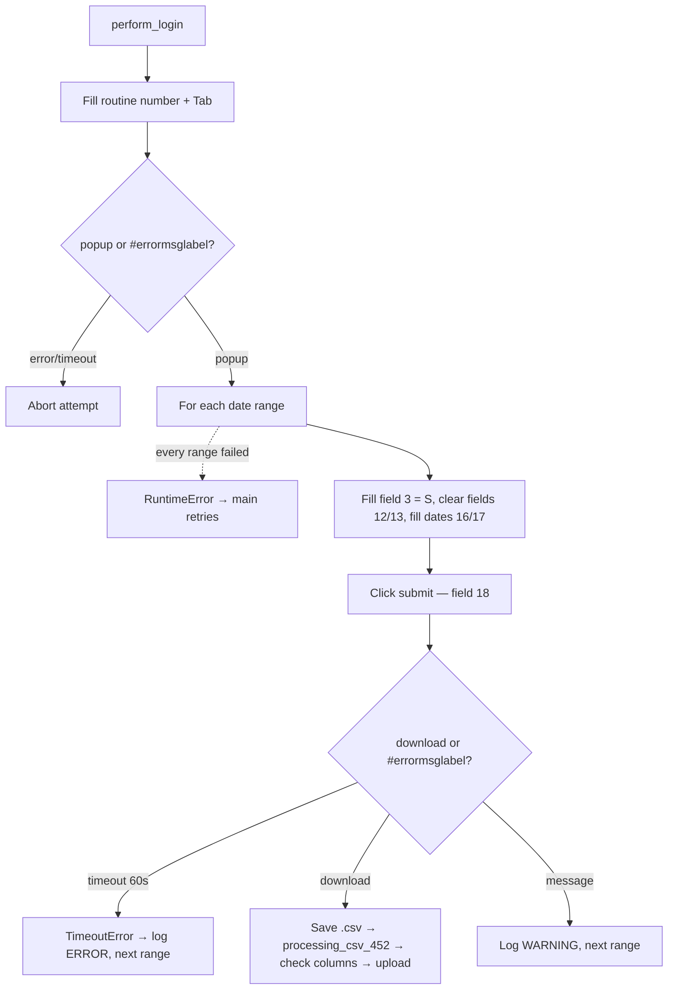

<h3># 📄 Routine 452</h3>

Automation for extracting, processing, and uploading the report for routine **452** of the SSW system to SharePoint.

---

## 📌 Objective

Run routine 452 in SSW for two periods (previous month + current month to date), download the `.csv`, process it with `Dataframe_Analytics().processing_csv_452()`, and upload it to SharePoint.

`processing_csv_452()` re-reads the file (`header=2`, `windows-1252`) and re-saves it in place without the SSW title lines, keeping every original column (plus pandas' `Unnamed: 22` for the trailing `;`) — it writes back to the same path, so no filename change is needed before upload.

---

## 📅 Business Rule (Dates)

| Condition | Periods processed | Function |
| --- | --- | --- |
| Always | Previous month (full) **and** current month up to today | `Dates().previous_and_current_month_ranges()` |

No day/hour gate: this routine belongs to the "always backfill last month" group (002, 036, 073, 076, 119, 200, 324, 411, 442, 452, 455ABH, 455CGK, 455F, 467 and 493), whose date helper is a one-to-one wrap of `Dates().previous_and_current_month_ranges()`.

Each range is isolated — a failure in one does not stop the other.

---

## 🔁 Execution Flow



---

## 🖱️ Screen Selectors

| Field | Selector | Note |
| --- | --- | --- |
| Routine number | `[id="\33 "]` | Triggers the popup via `Tab` |
| Type field | `[id="3"]` | Filled with `S` at the start of every range (same value, harmless) |
| Field 12 | `[id="\31 2"]` | Cleared (`""`) before every range |
| Field 13 | `[id="\31 3"]` | Cleared (`""`) before every range |
| Start date | `[id="\31 6"]` | |
| End date | `[id="\31 7"]` | |
| Submit | `[id="\31 8"]` | Plain `.click()` on the element, not a named link |
| Error label | `#errormsglabel` | |
| Confirm button | link **"7. OK"** | |

---

## ⚠️ Error Handling

| Scenario | Trigger | Action |
| --- | --- | --- |
| Timeout at the menu | Neither popup nor error within 10s | `TimeoutError`, attempt fails |
| Timeout per range | Neither download nor message within 60s | `TimeoutError` → logged `ERROR` by the loop, next range |
| Download OK | `download` event | Processes via Pandas in a separate thread, checks columns, uploads, logs `INFO` |
| Message on the form | `#errormsglabel` visible | Closes modal, logs `WARNING`, next range (not a failure) |
| Every date range failed | Every `_process_date_range` call raised | `RuntimeError` "All N date range(s) failed" → attempt fails, `main()` retries |
| `"Opção não liberada"` (option not released) | `MSG_NOT_RELEASED` | Aborts the remaining attempts |

---

## 🔄 Resilience

- Up to **3 attempts** (`MAX_ATTEMPTS`), with `5s` between them.
- Standard multi-range loop: `handler_download` runs `_process_date_range` once per date range; a failure is logged as one `ERROR` line and the next date range still runs. The attempt only fails (and `main()` retries) when **every** date range failed.
- Aborts before the 3rd attempt if the message is `MSG_NOT_RELEASED`.
- Single cleanup at the end: domain log upload + `GarbageCollector` on `output/downloads/452/`.

---

## 🛡️ Column Sentinel

Every downloaded file is checked against a fixed column baseline before the upload. The result is **one line in the domain log** — the upload always proceeds (see [column_sentinel.md](./column_sentinel.md)).

| Baseline | Columns | Header |
| --- | --- | --- |
| `config/sentinel/452.yml` | 23 | line 1 |

- **Where it runs:** `bot_452.py → _process_date_range`, right after `processing_csv_452`.
- **Processing before the check:** `processing_csv_452` only drops the SSW title lines and keeps every original column, so this is a real check of the SSW layout (not dormant).
- **Note:** Column W (`'Unnamed: 22'`) is the empty column from SSW's trailing `;`, named by pandas. If SSW adds a column, it shifts too — e.g. `ADDED: [M] 'nova_coluna' | RENAMED: [X] 'Unnamed: 22' -> 'Unnamed: 23'`.

Log line when the layout is intact:

```
INFO - TEC SENTINEL | 452 | 2026-09-TEC-452.csv | Columns: 23 found / 23 expected | OK
```

Any change shows up as `DRIFT` with `ADDED` / `REMOVED` / `RENAMED` / `MOVED` and the Excel column letter; a broken baseline shows up as `ERROR`.

---

## 📤 Output

- File: `output/downloads/452/20YY-MM-<DOMAIN>-452.csv` (downloaded, then re-saved in place by `Dataframe_Analytics().processing_csv_452()`)
- SharePoint destination: `Banco_de_Dados/<DOMAIN>/452`

---

## 🗂 Related Files

- `app/routines/bot_452.py` — routine code.
- `app/core/data_processing.py` — CSV post-processing (`Dataframe_Analytics.processing_csv_452()`).
- `app/utils/datetime_utils.py` — `previous_and_current_month_ranges()`.
- `app/core/login.py` / `app/core/upload_to_sharepoint.py` / `app/utils/custom_logger.py` / `app/utils/cleanup.py`
- `app/core/column_sentinel.py` — column check (see [column_sentinel.md](./column_sentinel.md)).
- `config/sentinel/452.yml` — column baseline.

---

## 📈 Example Run

```bash
uv run python main.py 452
```

[⬅ Back to main README](../README.md)
