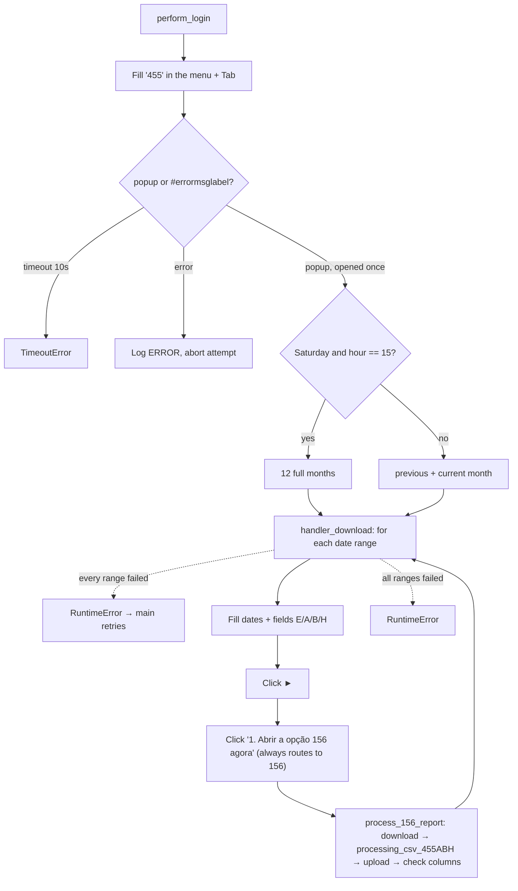

<h3># 📄 Routine 455ABH</h3>

Automation for generating and uploading the report for routine **455** (ABH variant) of the SSW system to SharePoint, always via screen 156.

---

## 📌 Objective

Run routine 455 filtering for the ABH variant (fields `A`/`B`/`H`), delegating each report to screen 156. Runs via `wf_daily.py` (Mon-Fri) and `wf_weekend.py` (Saturday); every run processes the previous month and the current month to date, except the Saturday 15h run, which backfills the last 12 full months.

---

## 📅 Business Rule (Dates)

The periods are decided in `_build_date_ranges()`:

| Condition | Periods processed | Function |
| --- | --- | --- |
| **Saturday** and hour == `BACKFILL_HOUR` (15h) | Last **12 full months** (current month excluded) | `Dates().previous_twelve_months_ranges()` |
| Any other day/hour | Previous month (full) **and** current month up to today | `Dates().previous_and_current_month_ranges()` |

Weekend backfill gate (user request, 2026-10-12): `BACKFILL_WEEKDAY` / `BACKFILL_HOUR` are module constants in `bot_455ABH.py` (Saturday, 15h). The hour must match the cron time of `WF_WE` in that company's `scripts/scheduler.sh` — if the workflow fires at another hour, the gate never matches and the run falls back to the two monthly ranges. Because of this gate, the routine is not in the "always backfill last month" group (002, 036, 073, 076, 119, 200, 324, 411, 442, 452, 467 and 493).

Each range is isolated — a failure in one does not stop the other — but if **every** range fails, the failure is re-raised so `main()`'s retry loop still engages. The 455 popup is opened **once** and reused for every range.

---

## 🔁 Execution Flow



Opening the routine races the popup against the menu-level error label (`MSG_NOT_RELEASED`) instead of assuming the popup always opens.

The 455 menu is shared between the ABH and CGK variants — the routine field always receives `"455"`, and it's the `A`/`B`/`H` fields (or `C`/`G`/`K` in the CGK variant) that decide which report comes out.

---

## 🖱️ Screen Selectors

| Field | Selector | Note |
| --- | --- | --- |
| Routine number | `[id="\33 "]` | Filled with `"455"` |
| Start date | `[id="\31 1"]` | |
| End date | `[id="\31 2"]` | |
| Field E | `[id="\33 5"]` | Filled with `E` |
| Field A | `[id="\33 7"]` | Filled with `A` |
| Field B | `[id="\33 8"]` | Filled with `B` |
| Field H | `[id="\33 9"]` | Filled with `H` |
| Submit button | link **"►"** | |
| Link to screen 156 | `"1. Abrir a opção 156 agora"` | Always clicked — there is no alternative path |
| Error label | `#errormsglabel` | Menu-level race only |
| Confirm button | link **"7. OK"** | Closes the menu-level error modal |

---

## ⚠️ Error Handling

| Scenario | Trigger | Action |
| --- | --- | --- |
| Timeout at the menu | Neither popup nor error within 10s | `TimeoutError`, attempt fails |
| Error opening the routine | `#errormsglabel` visible after `Tab` | Closes modal, logs `ERROR`, `RuntimeError` propagated |
| Failure processing one range | `_process_date_range` raised (popup, screen 156, processing or download failure) | Logged `ERROR` by the loop with the range, next range |
| Every date range failed | Every `_process_date_range` call raised | `RuntimeError` "All N date range(s) failed" → attempt fails, `main()` retries |
| `"Opção não liberada"` (option not released) | `MSG_NOT_RELEASED` | Aborts the remaining attempts |

This routine does not interpret intermediate screen messages — the only expected outcome per range is routing to 156; any exception there is caught, logged, and the loop moves on.

---

## 🔄 Resilience

- Up to **3 attempts** (`MAX_ATTEMPTS`), with `5s` between them.
- Standard multi-range loop: `handler_download` runs `_process_date_range` once per date range; a failure is logged as one `ERROR` line and the next date range still runs. The attempt only fails (and `main()` retries) when **every** date range failed.
- Aborts before the 3rd attempt if the message is `MSG_NOT_RELEASED`.
- Single cleanup at the end: `GarbageCollector` on `output/downloads/455ABH/`, then the domain log upload, then the `Main routine completed.` line — always the last line of the run.

---

## 🛡️ Column Sentinel

Every downloaded file is checked against a fixed column baseline right after the upload. The result is **one line in the domain log**, which closes that file's block — it never raises and never affects the upload (see [column_sentinel.md](./column_sentinel.md)).

| Baseline | Columns | Header |
| --- | --- | --- |
| `config/sentinel/455ABH.yml` | 118 | line 2 (line 1 is the SSW title) |

- **Where it runs:** `downloads.py → process_156_report`, right after `processing_csv_455ABH` and after `upload_report_file(...)`.
- **Processing before the check:** `processing_csv_455ABH` runs **first** — it renames known SSW changes (`Base Calculo ICMS/ISS` → `Base de Calculo`, `Complemento da Ultima Ocorrencia` → `Descricao da Ultima Ocorrencia`) and drops `Unnamed` columns. The baseline describes that processed file (the layout Power BI expects), so known renames never raise an alert.
- **Note:** Column 1 (`'1'`) is the SSW row counter and is part of the baseline. A new SSW rename is fixed in `processing_csv_455ABH`, not in the YAML.

Log line when the layout is intact:

```
SNTL - RPV SENTINEL 455ABH | 2026-09-RPV-455ABH.csv | Columns: 118 found / 118 expected | OK
```

Any change shows up as `DRIFT` with `ADDED` / `REMOVED` / `RENAMED` / `MOVED` and the Excel column letter; a broken baseline shows up as `ERROR`.

---

## 📤 Output

- The actual download is handled by `process_156_report` (screen 156), once per range.
- SharePoint destination: `Banco_de_Dados/<DOMAIN>/455` (the ABH variant maps to the shared `455` folder in `_resolve_remote_folder`).

---

## 🗂 Related Files

- `app/routines/bot_455ABH.py` — routine code.
- `app/routines/wf_daily.py` — Mon-Fri scheduling (BLOCK_1H / BLOCK_12H).
- `app/routines/wf_weekend.py` — Saturday scheduling.
- `app/core/downloads.py` — screen 156 monitoring (`process_156_report`).
- `app/utils/datetime_utils.py` — period calculation (`Dates`).
- `app/core/upload_to_sharepoint.py` — shared-folder rule for `455` (`_resolve_remote_folder`).
- `app/core/login.py` / `app/utils/custom_logger.py` / `app/utils/cleanup.py`
- `app/core/column_sentinel.py` — column check (see [column_sentinel.md](./column_sentinel.md)).
- `config/sentinel/455ABH.yml` — column baseline.

See also: [455CGK](./bot_455CGK.md) (same screen, different filter, run on Sunday).

---

## 📈 Example Run

```bash
uv run python main.py 455ABH
```

[⬅ Back to main README](../README.md)
