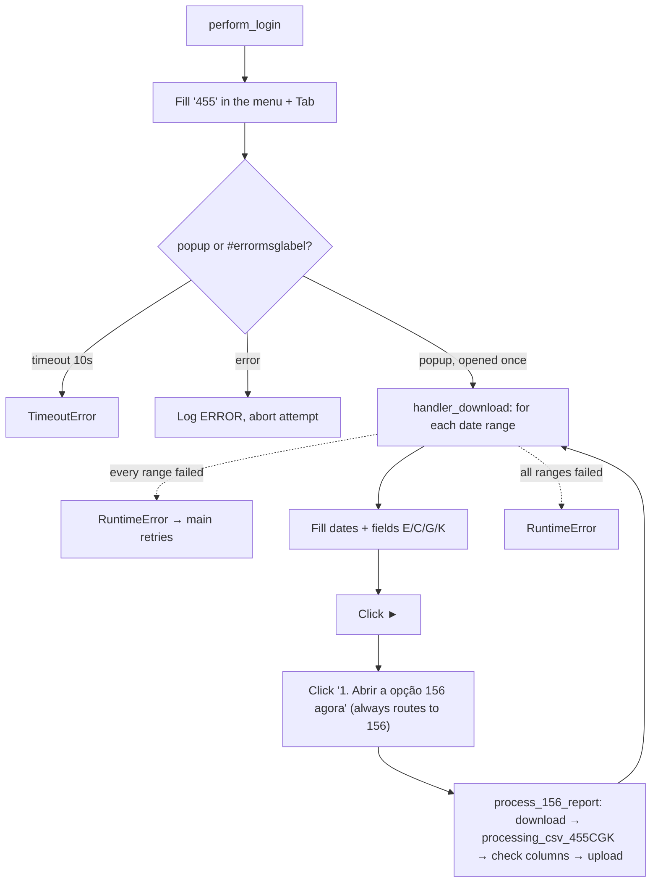

<h3># 📄 Routine 455CGK</h3>

Automation for generating and uploading the report for routine **455** (CGK variant) of the SSW system to SharePoint, always via screen 156.

---

## 📌 Objective

Run routine 455 filtering for the CGK variant (fields `C`/`G`/`K`), delegating each report to screen 156. Runs via `wf_daily.py` (Mon-Fri) and `wf_weekend.py` (Sunday); every run processes two periods — the previous month and the current month to date.

---

## 📅 Business Rule (Dates)

The periods are decided in `_build_date_ranges()`:

| Condition | Periods processed | Function |
| --- | --- | --- |
| Always | Previous month (full) **and** current month up to today | `Dates().previous_and_current_month_ranges()` |

No day/hour gate and no weekend-specific backfill: this routine belongs to the "always backfill last month" group (002, 036, 073, 076, 119, 200, 324, 411, 442, 452, 455ABH, 455CGK, 455F, 467 and 493), whose date helper is a one-to-one wrap of `Dates().previous_and_current_month_ranges()`.

Each range is isolated — a failure in one does not stop the other — but if **every** range fails, the failure is re-raised so `main()`'s retry loop still engages. The 455 popup is opened **once** and reused for both ranges.

---

## 🔁 Execution Flow



Opening the routine races the popup against the menu-level error label (`MSG_NOT_RELEASED`) instead of assuming the popup always opens.

Same shared screen as [455ABH](./bot_455ABH.md) — here the fields are filled with `C`/`G`/`K` instead of `A`/`B`/`H`, producing the CGK report instead of ABH.

---

## 🖱️ Screen Selectors

| Field | Selector | Note |
| --- | --- | --- |
| Routine number | `[id="\33 "]` | Filled with `"455"` |
| Start date | `[id="\31 1"]` | |
| End date | `[id="\31 2"]` | |
| Field E | `[id="\33 5"]` | Filled with `E` |
| Field C (`SEL_FIELD_A`) | `[id="\33 7"]` | Filled with `C` — constant named by its position on the shared 455 screen |
| Field G (`SEL_FIELD_B`) | `[id="\33 8"]` | Filled with `G` |
| Field K (`SEL_FIELD_H`) | `[id="\33 9"]` | Filled with `K` |
| Submit button | link **"►"** | |
| Link to screen 156 | `"1. Abrir a opção 156 agora"` | Always clicked |
| Error label | `#errormsglabel` | Menu-level race only |
| Confirm button | link **"7. OK"** | Closes the menu-level error modal |

---

## ⚠️ Error Handling

| Scenario | Trigger | Action |
| --- | --- | --- |
| Timeout at the menu | Neither popup nor error within 10s | `TimeoutError`, attempt fails |
| Error opening the routine | `#errormsglabel` visible after `Tab` | Closes modal, logs `ERROR`, `RuntimeError` propagated |
| Failure processing one range | `_process_date_range` raised (popup, screen 156, processing or download failure) | Logged `ERROR` by the loop with the range, next range |
| Every date range failed | Every `_process_date_range` call raised | `RuntimeError` "All N date range(s) failed" → attempt fails, `main()` retries |
| `"Opção não liberada"` (option not released) | `MSG_NOT_RELEASED` | Aborts the remaining attempts |

---

## 🔄 Resilience

- Up to **3 attempts** (`MAX_ATTEMPTS`), with `5s` between them.
- Standard multi-range loop: `handler_download` runs `_process_date_range` once per date range; a failure is logged as one `ERROR` line and the next date range still runs. The attempt only fails (and `main()` retries) when **every** date range failed.
- Aborts before the 3rd attempt if the message is `MSG_NOT_RELEASED`.
- Single cleanup at the end: domain log upload + `GarbageCollector` on `output/downloads/455CGK/`.

---

## 🛡️ Column Sentinel

> ⚠️ **Dormant today.** `processing_csv_455CGK` rewrites the file with exactly `config.yml → columns_455CGK`, so the processed header always equals that list; a removed/renamed SSW column fails earlier with `KeyError`, and added/moved ones are dropped or reordered. So this check logs `OK` whatever SSW changes — it **validates nothing** while the routine is built this way. The baseline is kept ready (decided with the user on 2026-09-27) for when the fixed column list is replaced by another method; at that point it starts catching real changes with no code change.

Every downloaded file is checked against a fixed column baseline before the upload. The result is **one line in the domain log** — the upload always proceeds (see [column_sentinel.md](./column_sentinel.md)).

| Baseline | Columns | Header |
| --- | --- | --- |
| `config/sentinel/455CGK.yml` | 31 | line 1 (processing drops the SSW title line) |

- **Where it runs:** `downloads.py → process_156_report`, right after `processing_csv_455CGK` and before `upload_report_file(...)`.
- **Processing before the check:** `processing_csv_455CGK` runs **first** — it keeps only the columns listed in `config.yml → variables.bot_455CGK.columns_455CGK`, in that order. The baseline must match that list exactly (same names, same order).
- **Note:** Known limitation: if SSW removes or renames one of the 31 selected columns, the processing raises `KeyError` before the check runs (logged as a range failure). Columns added or moved in the raw file don't reach the output, so they are not flagged.

Log line when the layout is intact:

```
INFO - RPV SENTINEL | 455CGK | 2026-08-RPV-455CGK.csv | Columns: 31 found / 31 expected | OK
```

Any change shows up as `DRIFT` with `ADDED` / `REMOVED` / `RENAMED` / `MOVED` and the Excel column letter; a broken baseline shows up as `ERROR`.

---

## 📤 Output

- The actual download is handled by `process_156_report` (screen 156), once per range.
- SharePoint destination: `Banco_de_Dados/<DOMAIN>/455CGK`

---

## 🗂 Related Files

- `app/routines/bot_455CGK.py` — routine code.
- `app/routines/wf_daily.py` — Mon-Fri scheduling (BLOCK_1H / BLOCK_12H).
- `app/routines/wf_weekend.py` — Sunday scheduling.
- `app/core/downloads.py` — screen 156 monitoring (`process_156_report`).
- `app/utils/datetime_utils.py` — period calculation (`Dates`).
- `config/settings/variables.py` — expected columns (`Bot455CGK.columns_455CGK`).
- `app/core/login.py` / `app/core/upload_to_sharepoint.py` / `app/utils/custom_logger.py` / `app/utils/cleanup.py`
- `app/core/column_sentinel.py` — column check (see [column_sentinel.md](./column_sentinel.md)).
- `config/sentinel/455CGK.yml` — column baseline.

See also: [455ABH](./bot_455ABH.md) (same screen, different filter, run on Saturday).

---

## 📈 Example Run

```bash
uv run python main.py 455CGK
```

[⬅ Back to main README](../README.md)
