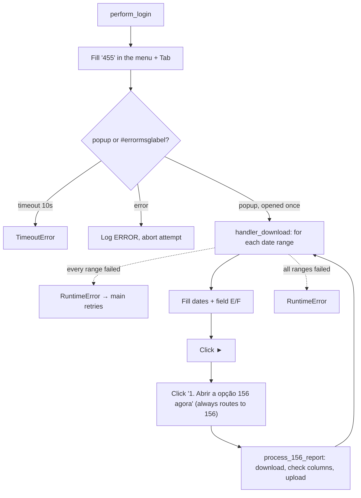

<h3># 📄 Routine 455F</h3>

Automation for generating and uploading the report for routine **455** (F variant) of the SSW system to SharePoint, always via screen 156.

---

## 📌 Objective

Run routine 455 filtering for the F variant (a single field filled with `F`, unlike ABH's `A`/`B`/`H` or CGK's `C`/`G`/`K`), delegating each report to screen 156. Every run processes two periods — the previous month and the current month to date — same as [455ABH](./bot_455ABH.md).

**Not yet wired into any workflow by default.** A commented-out call exists in `wf_weekend.py`'s Saturday block (alongside 455ABH) — enable it only for the specific domain(s) that requested this variant; it is not part of the standard weekend run.

---

## 📅 Business Rule (Dates)

The periods are decided in `_build_date_ranges()`:

| Condition | Periods processed | Function |
| --- | --- | --- |
| Always | Previous month (full) **and** current month up to today | `Dates().previous_and_current_month_ranges()` |

No day/hour gate and no weekend-specific backfill: this routine belongs to the "always backfill last month" group (002, 036, 073, 076, 119, 200, 324, 411, 442, 452, 455ABH, 455CGK, 455F, 467 and 493), whose date helper is a one-to-one wrap of `Dates().previous_and_current_month_ranges()`.

Each range is isolated — a failure in one does not stop the other — but if **every** range fails, the failure is re-raised so `main()`'s retry loop still engages. The 455 popup is opened **once** and reused for both ranges.

---

## 🔁 Execution Flow



Opening the routine races the popup against the menu-level error label (`MSG_NOT_RELEASED`) instead of assuming the popup always opens.

The 455 menu is shared between the ABH, CGK, and F variants — the routine field always receives `"455"`, and it's the field(s) filled after (`A`/`B`/`H`, `C`/`G`/`K`, or just `F`) that decide which report comes out.

---

## 🖱️ Screen Selectors

| Field | Selector | Note |
| --- | --- | --- |
| Routine number | `[id="\33 "]` | Filled with `"455"` |
| Start date | `[id="\31 1"]` | |
| End date | `[id="\31 2"]` | |
| Field E | `[id="\33 5"]` | Filled with `E` |
| Field A | `[id="\33 7"]` | Filled with `F` (the only variant field this routine uses) |
| Submit button | link **"►"** | |
| Link to screen 156 | `"1. Abrir a opção 156 agora"` | Always clicked — there is no alternative path |
| Error label | `#errormsglabel` | Menu-level race only |
| Confirm button | link **"7. OK"** | Closes the menu-level error modal |

---

## ⚠️ Error Handling

| Scenario | Trigger | Action |
| --- | --- | --- |
| Timeout at the menu | Neither popup nor error within 10s | `TimeoutError`, attempt fails |
| Error opening the routine | `#errormsglabel` visible after `Tab` | Closes modal, logs `ERROR`, `RuntimeError` propagated |
| Failure processing one range | `_process_date_range` raised (popup, screen 156 or download failure) | Logged `ERROR` by the loop with the range, next range |
| Every date range failed | Every `_process_date_range` call raised | `RuntimeError` "All N date range(s) failed" → attempt fails, `main()` retries |
| `"Opção não liberada"` (option not released) | `MSG_NOT_RELEASED` | Aborts the remaining attempts |

---

## 🔄 Resilience

- Up to **3 attempts** (`MAX_ATTEMPTS`), with `5s` between them.
- Standard multi-range loop: `handler_download` runs `_process_date_range` once per date range; a failure is logged as one `ERROR` line and the next date range still runs. The attempt only fails (and `main()` retries) when **every** date range failed.
- Aborts before the 3rd attempt if the message is `MSG_NOT_RELEASED`.
- Single cleanup at the end: domain log upload + `GarbageCollector` on `output/downloads/455F/`.

---

## 🛡️ Column Sentinel

Every downloaded file is checked against a fixed column baseline before the upload. The result is **one line in the domain log** — the upload always proceeds (see [column_sentinel.md](./column_sentinel.md)).

| Baseline | Columns | Header |
| --- | --- | --- |
| `config/sentinel/455F.yml` | 90 | auto-detected |

- **Where it runs:** `downloads.py → process_156_report`, right after the file is saved (`_handle_455F`, no processor) and before the upload — covered automatically because the baseline exists; no hook in the bot.
- **Processing before the check:** None — the raw SSW file is checked, exactly as it is uploaded.
- **Note:** SSW ends every line with `;`, which produces an empty 91st column; it is ignored, so the baseline lists 90.

Log line when the layout is intact:

```
INFO - TEC SENTINEL | 455F | 2026-09-TEC-455F.csv | Columns: 90 found / 90 expected | OK
```

Any change shows up as `DRIFT` with `ADDED` / `REMOVED` / `RENAMED` / `MOVED` and the Excel column letter; a broken baseline shows up as `ERROR`.

---

## 📤 Output

- The actual download is handled by `process_156_report` (screen 156), once per range.
- SharePoint destination: `Banco_de_Dados/<DOMAIN>/455` (the F variant maps to the shared `455` folder in `_resolve_remote_folder`, same as ABH/CGK).

---

## 🗂 Related Files

- `app/routines/bot_455F.py` — routine code.
- `app/routines/wf_weekend.py` — Saturday block has a commented-out call to this routine (disabled by default).
- `app/core/downloads.py` — screen 156 monitoring (`process_156_report`).
- `app/utils/datetime_utils.py` — period calculation (`Dates`).
- `app/core/login.py` / `app/core/upload_to_sharepoint.py` / `app/utils/custom_logger.py` / `app/utils/cleanup.py`
- `app/core/column_sentinel.py` — column check (see [column_sentinel.md](./column_sentinel.md)).
- `config/sentinel/455F.yml` — column baseline.

See also: [455ABH](./bot_455ABH.md) (same screen, different filter) and [455CGK](./bot_455CGK.md) (same screen, different filter).

---

## 📈 Example Run

```bash
uv run python main.py 455F
```

[⬅ Back to main README](../README.md)
