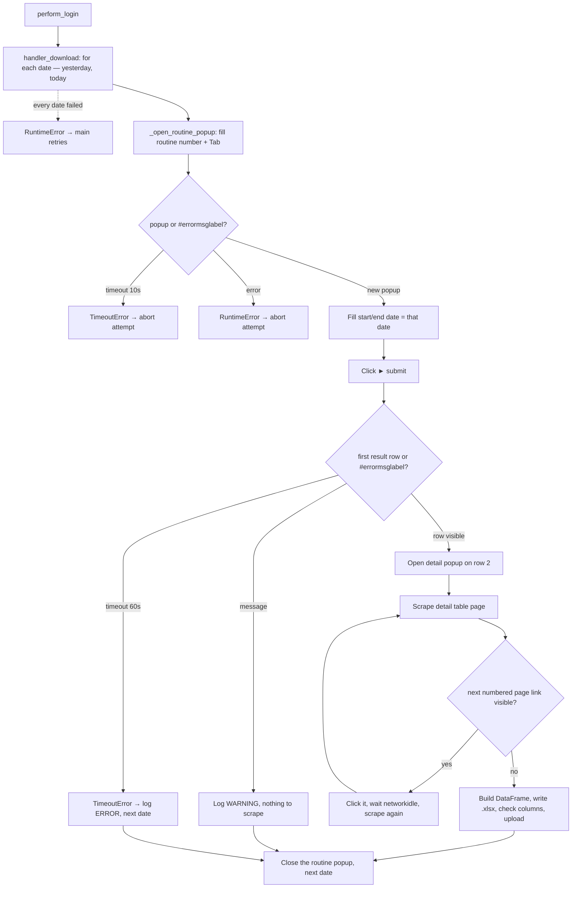

<h3># 📄 Routine 458</h3>

Automation for extracting the daily bank-balance snapshot (yesterday and today, one file per day) for routine **458** of the SSW system and uploading it to SharePoint.

Unlike most routines in this repo, SSW never offers a file download here: the popup shows a results table whose single row opens a second (detail) popup with a paginated table. The bot scrapes that paginated table itself and builds the `.xlsx` report from the scraped rows.

---

## 📌 Objective

Run routine 458 in SSW for yesterday and today (one single-day search each), scrape the resulting bank-balance detail table (across all its pages), and upload one assembled `.xlsx` per day to SharePoint.

---

## 📅 Business Rule (Dates)

| Condition | Dates processed | Function |
| --- | --- | --- |
| Always | Yesterday **and** today — each as its own single-day search (start = end) | `_build_dates_to_process()` → `Dates().yesterday_and_today()` |

No day/hour gate. Changed on 2026-09-27 at the user's request (it used to query today only) — same dates as [930](./bot_930.md). Each date is isolated: a failure in one does not stop the other, and the attempt only fails (triggering a retry) when **both** dates failed.

---

## 🔁 Execution Flow



**A fresh routine popup per date** (like `bot_081.py`/`bot_019.py` per unit): the search is raced against the *first result row* becoming visible, and reusing one popup would leave the previous date's row on screen, so the second race would resolve instantly on stale results. Each popup is closed after its date. Opening the popup races it against the menu-level error label (`MSG_NOT_RELEASED`) instead of assuming it always opens; a menu-level failure aborts the attempt (it would hit every date alike). Inside the popup, the search submit is raced the same way — against the first result row instead of a browser `download` event, since this screen never fires one.

---

## 🖱️ Screen Selectors

| Field | Selector | Note |
| --- | --- | --- |
| Routine number | `[id="\33 "]` | Triggers the popup via `Tab` |
| Start date | `[id="\31 "]` | Filled with today's date |
| End date | `[id="\32 "]` | Filled with today's date |
| Submit button | link **"►"** | |
| First result row link | `#tblsr > tbody > tr:nth-child(2) > td:nth-child(1) > div > a` | Opens the detail popup; this screen always has exactly one result row |
| Detail table row | `#tblsr > tbody > tr:nth-child({row})` | Inside the detail popup; row 1 is the header |
| Next detail page link | link with the target page number, e.g. `"2"` | `exact=True`; absent once the last page is reached |
| Error label | `#errormsglabel` | |
| Confirm button | link **"7. OK"** | |

---

## ⚠️ Error Handling

| Scenario | Trigger | Action |
| --- | --- | --- |
| Timeout at the menu | Neither popup nor error within 10s (any date) | `TimeoutError`, attempt fails |
| Error opening the routine | `#errormsglabel` visible after `Tab` (any date) | Closes modal, `RuntimeError` propagated — attempt fails (logged once by `run()`) |
| Timeout at the search | Neither the result row nor a message within 60s | `TimeoutError` → logged `ERROR` by the loop, next date |
| Message instead of a result row | `#errormsglabel` visible after submit | Dismiss (if any text), log `WARNING`, nothing scraped (not a failure) |
| No rows scraped despite a result row appearing | `_scrape_all_detail_pages()` returns empty | Log `WARNING`, nothing uploaded (not a failure) |
| Every date failed | Every `_process_date` call raised | `RuntimeError` "All N date(s) failed" → attempt fails, `main()` retries |
| `"Opção não liberada"` (option not released) | `MSG_NOT_RELEASED` | Aborts the remaining attempts |

---

## 🔄 Resilience

- Up to **3 attempts** (`MAX_ATTEMPTS`), with `5s` between them.
- Aborts before the 3rd attempt if the message is `MSG_NOT_RELEASED`.
- Standard loop: `handler_download` runs `_process_date` once per date, each on its own popup; a failure is logged as one `ERROR` line and the next date still runs. The attempt only fails (and `main()` retries) when **every** date failed.
- Single cleanup at the end: domain log upload + `GarbageCollector` on `output/downloads/458/`.

---

## 🛡️ Column Sentinel

> ⚠️ **Dormant today.** The `.xlsx` header comes from `DETAIL_COLUMNS`, hard-coded in `bot_458.py`, and scraped cells are mapped to it **by position**. So this check logs `OK` whatever SSW changes — it **validates nothing** while the routine is built this way. The baseline is kept ready (decided with the user on 2026-09-27) for when the header is read from the SSW table instead; at that point it starts catching real changes with no code change.

Every built file is checked against a fixed column baseline before the upload. The result is **one line in the domain log** — the upload always proceeds (see [column_sentinel.md](./column_sentinel.md)).

| Baseline | Columns | Header |
| --- | --- | --- |
| `config/sentinel/458.yml` | 9 | line 1 (first row of the `.xlsx`) |

- **Where it runs:** `bot_458.py → _process_date`, right after the `.xlsx` is written and before `upload_report_file(...)`.
- **Processing before the check:** None from `data_processing.py` — the bot itself builds the `.xlsx` from the scraped rows.
- **Note:** Tested on 2026-09-27: if SSW inserts a column after `Banco`, the check still logs `OK`, but the values shift silently (`Agencia` gets the new column's value, `Status` gets the balance, and so on). Reading the detail table's own header row (row 1) and using it as the column names would turn this into a real check.

Log line when the layout is intact:

```
INFO - TEC SENTINEL | 458 | 2026-09-27-TEC-458.xlsx | Columns: 9 found / 9 expected | OK
```

Any change shows up as `DRIFT` with `ADDED` / `REMOVED` / `RENAMED` / `MOVED` and the Excel column letter; a broken baseline shows up as `ERROR`.

---

## 📤 Output

- Files: `output/downloads/458/20YY-MM-DD-<DOMAIN>-458.xlsx`, one per date (yesterday and today) — the day is in the name, so each snapshot has its own file.
- SharePoint destination: `Banco_de_Dados/<DOMAIN>/458`.

---

## 🗂 Related Files

- `app/routines/bot_458.py` — routine code.
- `app/utils/datetime_utils.py` — `yesterday_and_today()`.
- `app/core/login.py` / `app/core/upload_to_sharepoint.py` / `app/utils/custom_logger.py` / `app/utils/cleanup.py`
- `app/core/column_sentinel.py` — column check (see [column_sentinel.md](./column_sentinel.md)).
- `config/sentinel/458.yml` — column baseline (dormant).

---

## 📈 Example Run

```bash
uv run python main.py 458
```

[⬅ Back to main README](../README.md)
