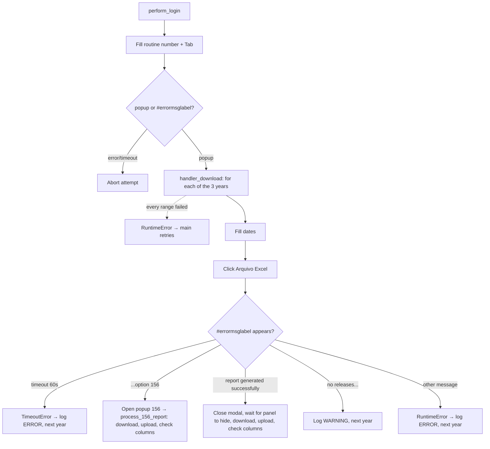

<h3># 📄 Routine 477</h3>

Automation for extracting, downloading, and uploading the expense report for routine **477** of the SSW system to SharePoint.

---

## 📌 Objective

Run routine 477 for three years of periods, routing between "no releases", screen 156, or local generation/download.

---

## 📅 Business Rule (Dates)

The periods queried are decided in `_build_date_ranges()`, always the full 3-year window — not gated by a day/hour check:

| Periods processed | Function |
| --- | --- |
| Last 3 years (one range per year) | `Dates().last_three_years_to_date_ranges()` |

Each range is isolated — a failure in one does not stop the others.

---

## 🔁 Execution Flow



---

## 🖱️ Screen Selectors

| Field | Selector | Note |
| --- | --- | --- |
| Routine number | `[id="\33 "]` | Triggers the popup via `Tab` |
| Start date | `#data_ini_inclusao_despesa` | |
| End date | `#data_fin_inclusao_despesa` | |
| Generate button | link **"Arquivo Excel"** | |
| Link to screen 156 | `"1. Abrir a opção 156 agora"` | |
| Error label | `#errormsglabel` | |
| Error panel | `#errorpanel` | Waited to be `hidden` before re-clicking Excel — the div intercepts pointer events while still visible, causing a 120s timeout on the click otherwise |
| Confirm button | link **"7. OK"** | |

---

## ⚠️ Error Handling

| Scenario | Trigger | Action |
| --- | --- | --- |
| Timeout at the menu | Neither popup nor error within 10s | `TimeoutError`, attempt fails |
| Timeout per year | No message within 60s | `TimeoutError` → logged `ERROR` by the loop, next year |
| `"...opção 156"` (screen 156) | Report sent for asynchronous processing | Opens popup and delegates to `process_156_report` |
| `"Relatório gerado com sucesso."` (report generated successfully) | Report ready locally | Waits for the error panel to close, fires another click on Excel, downloads, uploads and checks columns |
| `"Não há lançamento(s)..."` (no releases) | No data for the period/unit | Logs `WARNING`, moves on |
| Other message | Text not recognized | Dismissed with OK, `RuntimeError` → logged `ERROR` by the loop, next year |
| Every date range failed | Every `_process_date_range` call raised | `RuntimeError` "All N date range(s) failed" → attempt fails, `main()` retries |
| `"Opção não liberada"` (option not released) | `MSG_NOT_RELEASED` | Aborts the remaining attempts |

---

## 🔄 Resilience

- Up to **3 attempts** (`MAX_ATTEMPTS`), with `5s` between them.
- Standard multi-range loop: `handler_download` runs `_process_date_range` once per date range; a failure is logged as one `ERROR` line and the next date range still runs. The attempt only fails (and `main()` retries) when **every** date range failed.
- Aborts before the 3rd attempt if the message is `MSG_NOT_RELEASED`.
- Single cleanup at the end: `GarbageCollector` on `output/downloads/477/`, then the domain log upload, then the `Main routine completed.` line — always the last line of the run.

---

## 🛡️ Column Sentinel

Every downloaded file is checked against a fixed column baseline right after the upload. The result is **one line in the domain log**, which closes that file's block — it never raises and never affects the upload (see [column_sentinel.md](./column_sentinel.md)).

| Baseline | Columns | Header |
| --- | --- | --- |
| `config/sentinel/477.yml` | 43 | auto-detected |

- **Where it runs:** Direct download: `bot_477.py → _process_date_range`, right after `download.save_as(...)`. Screen-156 path: `downloads.py → process_156_report` (`_handle_477`, no processor).
- **Processing before the check:** None — the raw SSW file is checked, exactly as it is uploaded.
- **Note:** The first column header is `'3'` (not the usual `'1'` row counter). The empty 44th column from SSW's trailing `;` is ignored, so the baseline lists 43.

Log line when the layout is intact:

```
SNTL - TEC SENTINEL 477 | 2026-TEC-477.csv | Columns: 43 found / 43 expected | OK
```

Any change shows up as `DRIFT` with `ADDED` / `REMOVED` / `RENAMED` / `MOVED` and the Excel column letter; a broken baseline shows up as `ERROR`.

---

## 📤 Output

- File: `output/downloads/477/20YY-<DOMAIN>-477.csv`
- SharePoint destination: `Banco_de_Dados/<DOMAIN>/477`

---

## 🗂 Related Files

- `app/routines/bot_477.py` — routine code.
- `app/core/downloads.py` — screen 156 monitoring (`process_156_report`).
- `app/utils/datetime_utils.py` — period calculation (`Dates`).
- `app/core/login.py` / `app/core/upload_to_sharepoint.py` / `app/utils/custom_logger.py` / `app/utils/cleanup.py`
- `app/core/column_sentinel.py` — column check (see [column_sentinel.md](./column_sentinel.md)).
- `config/sentinel/477.yml` — column baseline.

---

## 📈 Example Run

```bash
uv run python main.py 477
```

[⬅ Back to main README](../README.md)
