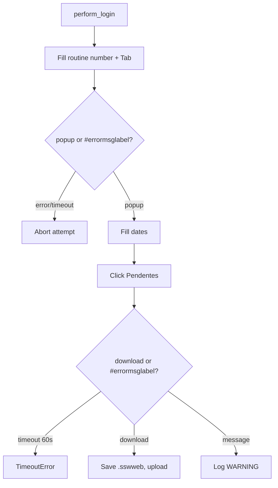

<h3># 📄 Routine 571</h3>

Automation for extracting, downloading, and uploading the pending-items report for routine **571** of the SSW system to SharePoint.

---

## 📌 Objective

Run routine 571 in SSW, from January 1st of the current year up to today, and upload the resulting `.sswweb` to SharePoint.

---

## 📅 Business Rule (Dates)

The period queried is decided in `_build_date_range()`, always year-to-date — not gated by a day/hour check:

| Period processed | Function |
| --- | --- |
| From January 1st of the current year to the current date | `Dates().year_to_date_range()` |

---

## 🔁 Execution Flow



---

## 🖱️ Screen Selectors

| Field | Selector | Note |
| --- | --- | --- |
| Routine number | `[id="\33 "]` | Triggers the popup via `Tab` |
| Start date | `[id="\32 8"]` | |
| End date | `[id="\32 9"]` | |
| Generate button | link **"Pendentes"** | |
| Error label | `#errormsglabel` | |
| Confirm button | link **"7. OK"** | |

---

## ⚠️ Error Handling

| Scenario | Trigger | Action |
| --- | --- | --- |
| Timeout at the menu | Neither popup nor error within 10s | `TimeoutError` |
| Timeout at the form | Neither download nor message within 60s | `TimeoutError` |
| Download OK | `download` event | Saves, uploads, logs `INFO` |
| Any message | `#errormsglabel` visible | Logs `WARNING` |
| `"Opção não liberada"` (option not released) | `MSG_NOT_RELEASED` | Aborts the remaining attempts |

---

## 🔄 Resilience

- Up to **3 attempts** (`MAX_ATTEMPTS`), with `5s` between them.
- Aborts before the 3rd attempt if the message is `MSG_NOT_RELEASED`.
- Single cleanup at the end: `GarbageCollector` on `output/downloads/571/`, then the domain log upload, then the `Main routine completed.` line — always the last line of the run.

---

## 🛡️ Column Sentinel — not guarded

Routine 571 has **no** column baseline (decided with the user on 2026-09-27; see [column_sentinel.md](./column_sentinel.md#routines-not-guarded)).

- SSW delivers a **pure `.sswweb` text report**, and it is uploaded exactly as downloaded — there is no processing step and no `.csv`/`.xlsx` with a column header for the sentinel to compare.
- So, for now, nothing checks this file's layout. If it ever needs guarding, the check would have to understand the `.sswweb` text layout itself (or come from a processing step that turns it into a table), not a header baseline.

---

## 📤 Output

- File: `output/downloads/571/20YY-<DOMAIN>-571.sswweb`
- SharePoint destination: `Banco_de_Dados/<DOMAIN>/571`

---

## 🗂 Related Files

- `app/routines/bot_571.py` — routine code.
- `app/utils/datetime_utils.py` — `year_to_date_range()`.
- `app/core/login.py` / `app/core/upload_to_sharepoint.py` / `app/utils/custom_logger.py` / `app/utils/cleanup.py`

---

## 📈 Example Run

```bash
uv run python main.py 571
```

[⬅ Back to main README](../README.md)
